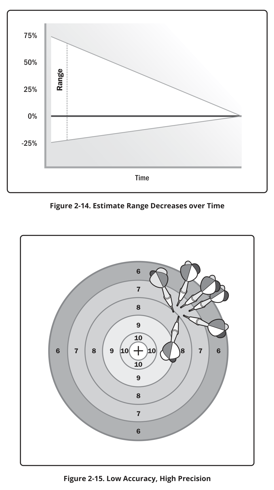
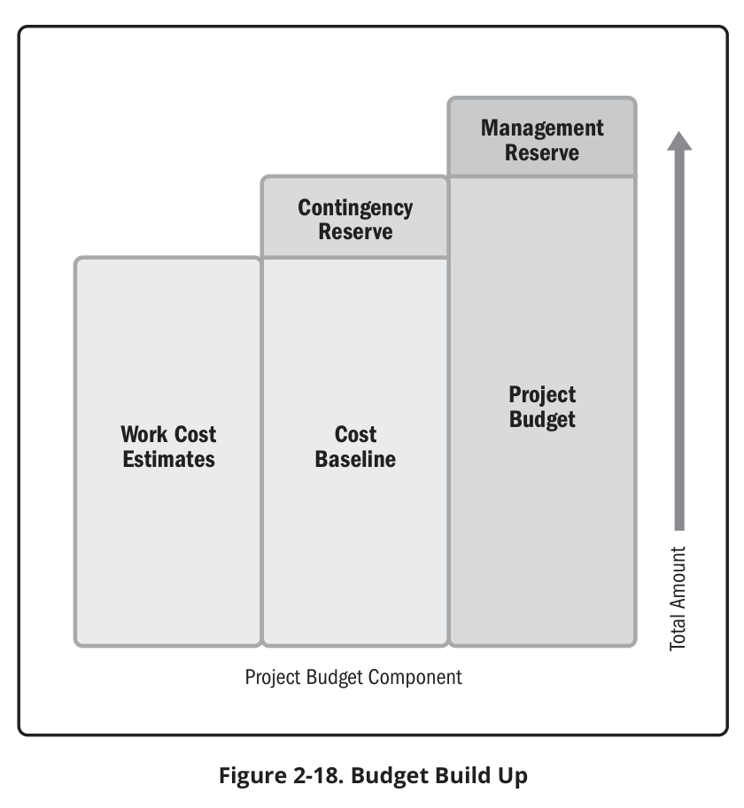
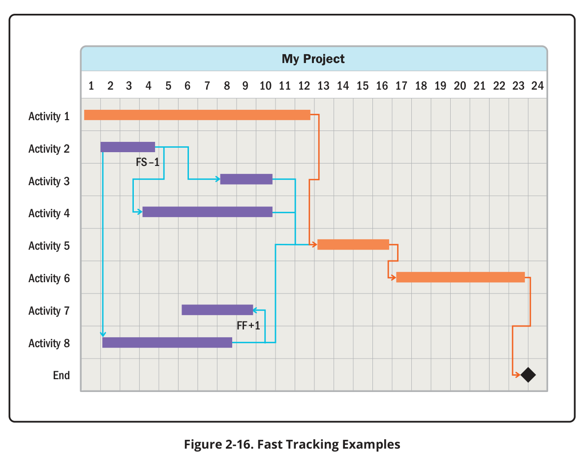
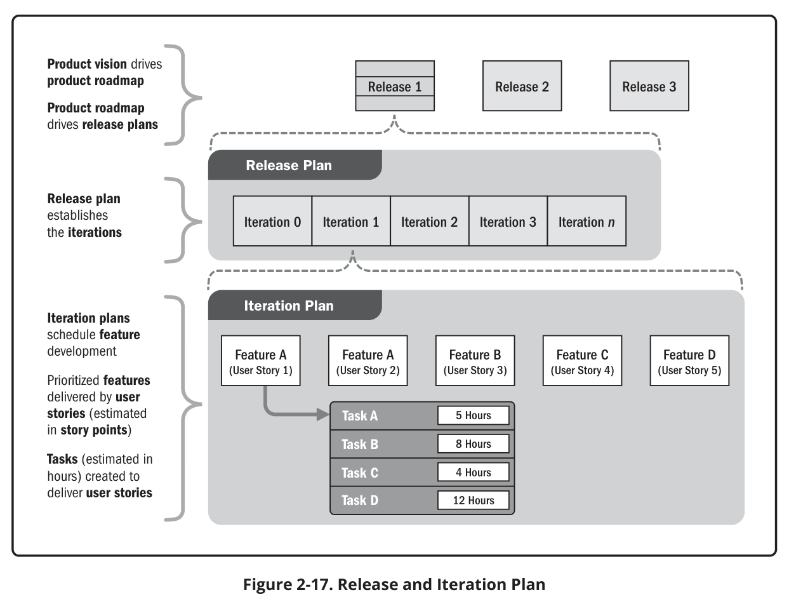

# Milestone 2: how to do each section (study notes)

Working notes for the CTRS group, not part of the submission. Due **Thu 15 Oct 2026** (Course Dropbox, myCourseVille); presented with Milestone 1 on Tue 20 Oct (Sec 1) / Sat 24 Oct (Sec 5).

Sources used, cited inline:

- **Lecture notes**: `ch5 S12` = chapter 5 slide 12, in [`materials/lecture_notes/chapter_0X/md/`](../../../../../materials/lecture_notes/) (ch5 scope, ch6 schedule, ch7 cost, ch9 resource, ch3 the JWD case study).
- **PMBOK7**: *PMBOK Guide* 7th ed., cited as printed page / PDF page; see the [TOC](../../../../../materials/textbooks/md/PMBOK_Guide_7th_Edition_TOC.md). PMBOK7 is principle-based; the course slides follow PMBOK 6 (process groups and knowledge areas), so **use the slide terminology first** and PMBOK7 for definitions.
- **Pet Care**: the 2025 sample report, [`examples/md/2025_Pet_Care…md`](../../received/examples/md/2025_Pet_Care-2311-17856882876674.md), PDF pages 53–73 (page images in `2025_Pet_Care-…_png/page-NN.png`).
- **M1**: our Milestone 1 [`part2-final-deliverables.md`](../milestone1/part2-final-deliverables.md).

---

## 0. The big picture

### What M2 asks for (brief, Milestone 2, 8 %)

| # | Deliverable | Knowledge area / slides |
|---|---|---|
| Part 1 | GenAI Log: **2 prompt records per member** (8 records), one per page | brief "GenAI Log file" |
| 1 | Review Board Decision Log | brief |
| 2 | Project scope statement: project summary, product characteristics and requirements, deliverables (PM-related + product-related), exclusions, success criteria | Scope, ch5 |
| 3 | WBS and tasks | Scope, ch5; activities ch6 |
| 4 | Effort estimation for tasks | Cost ch7, Schedule ch6 |
| 5 | Human and physical resource assignment to tasks, resource rates | Resource ch9 |
| 6 | Cost estimation: labor + other costs + contingency reserve, **aligned with assignment, rates and effort** | Cost ch7 |
| 7 | Schedule from WBS/tasks with resources: **Gantt chart view and critical path** | Schedule ch6 |

Scoring: PMBOK correctness, **consistency between artifacts**, quality of critical reasoning in prompting, presentation. Deliverables must be "correct and complete but CONCISE".

### One chain, built in this order

The seven items are one model. Every number flows from the WBS, so build them in this order (this is exactly what the JWD case does, ch3 S23–24: scope statement and WBS together, then ask each member which tasks they do and how many hours a month they can give, then dependencies, hours per task, durations, critical path, adjust to the charter's dates):

```
Scope statement ──► WBS (work packages) ──► activities/tasks
                                               │
                         effort (person-hours) per task  ◄── estimation method(s)
                                               │
                  resource assignment (who, % units) + rates (THB/h)
                         │                         │
         duration = effort ÷ (hours/day × units)   labor cost = hours × rate
                         │                         │
       dependencies ──► schedule, Gantt, critical path      + other costs + contingency
                                                   │
                                     cost baseline (time-phased)
```

Do it **in a scheduling tool** (ProjectLibre or GanttProject, both listed in the syllabus §15.4): enter WBS + tasks + dependencies + resources with rates + work (hours) once, and the tool gives you durations, Gantt, critical path, resource usage and cost per task. Export tables from the same file, so items 3–7 can't contradict each other. This is the single most important lesson from Pet Care, whose numbers disagree across tables (see §8).

### Anchors from M1 that M2 must stay consistent with

| Item | M1 value (where) |
|---|---|
| Dates | 3 Aug 2026 to 28 Jul 2028; iterations I1, I2, E1, E2, C1, C2, T1, C3, T2, P1, C4, T3, close-out (Table 2.21) |
| Milestones | LCO 2 Sep 2026 · LCA 23 Oct 2026 · IOC 26 Feb 2027 · R1.0 in operation 2 Apr 2027 · R2.0 30 Jul 2027 · R2.1 11 Feb 2028 · expansion decision / close 28 Jul 2028 |
| Scope | Releases 1.0 (F1–F28), 2.0 (F29–F35), 2.1 productization; Future F36, F37 out of scope (Tables 2.13–2.18) |
| Quality targets | 5 TPS, 2 s response, 15 s check-in, 2 h recovery, browsers, daily backup (Table 2.19) |
| Team and rates | Boonnisa T. PM 350 THB/h · Sirapatr C. SA 350 · Chawanakorn S. Req. Specifier/Designer 300 · Watayut A. QA/Tester 300 (Table 3.4) |
| Effort (top-down) | 2,632 h total: Year 0 2,092 h, Year 1 540 h, split by phase and person (Table 3.4) |
| Budget | 1,010,590 THB = Year 0 767,690 (labor 674,600 + devices 15,000 + hosting/domain 8,300 + contingency 69,790) + Year 1 242,900 (labor 172,000 + legal 15,000 + hosting/support 37,200 + contingency 18,700) (Tables 2.20, 3.7) |
| Risks | RISK-01 … RISK-14 (Table 2.24), which justify the contingency reserve |
| Success criteria | 7 criteria in the charter (Table 4.1) |

M1 itself promises: *"Milestone 2 replaces this top-down figure by a bottom-up estimate per WBS task"* (§3.3.1). So M2's headline is: **bottom-up effort and cost per WBS task, compared with the M1 top-down estimate**. If the totals change, say so: add a row to the Document Revision History, record the decision in the Review Board log, and update the budget/charter figure or explain the variance.

---

## 1. Review Board Decision Log

**Format** (brief): `No. | Artifact | Member (prompt design) | Suggestion from team (in brief) | Decision (Accept / Revise / Reject)`. Same as M1 Table 1.1; copy its style (one row per artifact or artifact part, a short concrete suggestion, a decision).

How to do it:

1. After each member's prompting, hold one Review Board meeting (all four) per artifact set.
2. Review each artifact against the three evaluation criteria of the brief: **Requirement Satisfaction**, **PMBOK Correctness**, **Project Consistency** (with M1 and with the other M2 artifacts).
3. Record concrete suggestions, e.g. "Effort for C1 payment tasks too low compared with M1 Table 3.4", "WBS mixes nouns and verbs", "Critical path list includes tasks with slack".
4. Make sure the member names match the GenAI log records (each member ≥ 2 prompts).

Pet Care has **no** decision log or GenAI section at all; don't use it as a model for this part.

---

## 2. Project scope statement

### Definitions

- **Scope** = "all the work involved in creating the products of the project and the processes used to create them" (ch5 S4). Scope management = "defining and controlling **what is or is not included**" (ch5 S4); "all the work required, and only the work required" (ch5 S33).
- **Project scope statement** = "The description of the project scope, major deliverables, and **exclusions**" (PMBOK7 glossary, p.236 / PDF 341). It identifies "the major deliverables … and the **acceptance criteria for each deliverable**" (PMBOK7 p.84 / PDF 179).
- **Product scope** = features and functions of the product; **project scope** = the work to deliver it (PMBOK7 p.54 / PDF 149).
- Deliverables are **product related** (e.g. software) or **process related** (e.g. planning documents, meeting minutes) (ch5 S4). These are the brief's "product-related" and "project management-related" deliverables.

<div class="figs">
<div class="row two">
<figure><figcaption>Figure 1. ch5 S12 · Contents of a project scope statement</figcaption></figure>
<figure><figcaption>Figure 2. ch5 S13 · Progressive elaboration: vague vs specific scope (Table 5-3)</figcaption></figure>
</div>
</div><!-- /figs -->

### Contents (ch5 S12 mapped to the brief's headings)

| Brief heading | Slide content (ch5 S12) | What to write for CTRS |
|---|---|---|
| Project summary | (Project title, date, justification) | Title, date, 3–5 sentence summary: La Loy pilot, LINE self-service reservation, two releases + productization, dates, budget (from charter). Don't leave it as filler: Pet Care's "Project Justification" just names the team. |
| Product characteristics and requirements | "Product scope description" | Releases 1.0 / 2.0 / 2.1 and the feature list by role (summarize M1 Tables 2.15–2.18 by feature ID; don't paste the whole tables again), quality targets of Table 2.19, legal (PDPA, Alcoholic Beverage Control Act). |
| Project deliverables: PM-related | "Detailed information on all project deliverables" | Business case, charter, scope statement, WBS + dictionary, schedule/cost baselines, quality/risk/communication plans, iteration plans and assessments, status reports, milestone review records (LCO, LCA, IOC, PR), pilot KPI reports, expansion decision record, lessons learned (M1 Table 2.23 lists them by phase). |
| Project deliverables: product-related | (same) | RUP artifacts (Vision, Use-Case Model, SRS, Supplementary Spec, SAD, UI prototype, test plan and cases), working builds per iteration, Release 1.0, 2.0, 2.1 in operation, user training material, data migration, deployment/hosting setup, operations/support routine. |
| What is excluded | "Project boundaries, constraints, and assumptions" | **Explicit list**: F36 split payment, F37 table photos, configurable business rules (Future); the restaurant's check-in tablet (La Loy buys it); LINE OA plan and gateway merchant fees (restaurant's operating cost); sales and onboarding of other restaurants after the gate (Years 2–5 operation, outside project); hardware at the venue; refunds policy decisions (the Owner's). Add the key assumptions and constraints (cite ASM/CON IDs from M1 §2.4). |
| Project success criteria | "Product user acceptance criteria" | Reuse the 7 charter success criteria **verbatim or by reference** plus acceptance criteria per major deliverable (e.g. "Release 1.0 accepted when acceptance tests of the two main use cases pass with the Manager and Front Staff"). Must be measurable. |
| (optional) | "Supporting document references" | Vision v1.x, SRS, Development Case in the 2110628 repo. |

Tips:

- Be **specific**: ch5 S13 contrasts a vague scope version ("if additional servers are required…") with a specific one ("purchase 10 new servers … details in Attachment 8"). Name feature IDs, dates and numbers.
- **Format**: Pet Care used a 2-column labelled table (Table 25). Copy that, but remove template leftovers (their product deliverables still say "research reports, design documents, software code, hardware, etc.").
- The scope statement + WBS + WBS dictionary = **scope baseline** (ch5 S14; PMBOK7 glossary p.239 / PDF 344).

<div class="figs">
<div class="row">
<figure><figcaption>Figure 3. Pet Care p.53 · Scope statement as a labelled table (Table 25)</figcaption></figure>
</div>
</div><!-- /figs -->

---

## 3. WBS and tasks

### Definitions and rules

- **WBS** = "a deliverable-oriented grouping of the work involved in a project that defines the total scope of the project", the "foundation document … for planning and managing project schedules, costs, resources, and changes" (ch5 S14). PMBOK7: "hierarchical decomposition of the total scope of work" (p.243 / PDF 348).
- **Work package** = "a task at the lowest level of the WBS" (ch5 S14); "for which cost and duration are estimated and managed" (PMBOK7 p.243 / PDF 348).
- "PMI recommends using **nouns** to name WBS items" (ch5 S14); activities below them are **verbs** (ch6 S8).
- Rules (ch5 S26), the course's version of the 100 % rule:
  - a unit of work appears in **only one place**;
  - the work content of a WBS item is the **sum** of the items below it;
  - each WBS item is the responsibility of **only one individual**;
  - the WBS must match how the work is actually going to be performed;
  - team members help build it;
  - each WBS item is documented in a **WBS dictionary**.
- Four approaches (ch5 S23): guidelines, analogy (tailor a similar project's WBS, e.g. Pet Care's), top-down, bottom-up.
- Ways to organize: by **product** (ch5 S15), by **phase** with a Project Management branch (ch5 S16–17: 1.1 Project Management, 1.2 Product Requirements, 1.3 Detail Design, 1.4 Construct, 1.5 Integration and Test), or by **process group** (ch5 S20, ch3 S24 "may use the process groups as the categories of work"). Agile: by process (ch5 S21, sprint tasks with Duration and Dependency) or by product (ch5 S22, product backlog = WBS: `EPIC ID | EPIC Name | User Story ID | User Story | Estimate (SP)`).

<div class="figs">
<div class="row two">
<figure><figcaption>Figure 4. ch5 S14 · WBS definition, work package, scope baseline</figcaption></figure>
<figure><figcaption>Figure 5. ch5 S26 · Advice for creating a WBS and WBS dictionary</figcaption></figure>
</div>
<div class="row two">
<figure><figcaption>Figure 6. ch5 S16 · WBS organized by phase (Figure 5-4)</figcaption></figure>
<figure><figcaption>Figure 7. ch5 S17 · Same WBS in tabular form (Table 5-4)</figcaption></figure>
</div>
<div class="row two">
<figure><figcaption>Figure 8. ch5 S21 · Agile WBS by process: sprint tasks with duration and dependency</figcaption></figure>
<figure><figcaption>Figure 9. ch5 S22 · Agile WBS by product: product backlog with story points</figcaption></figure>
</div>
</div><!-- /figs -->

### Suggested WBS for CTRS (tailored RUP, phase/iteration then deliverable)

Level 1 project, level 2 phase (plus a PM branch), level 3 iteration, level 4 work packages (nouns); activities/tasks under them carry the effort. Keep **one numbering scheme** and use it in every table and in the tool.

```
1 CTRS Project
1.1 Project Management                 (process-related, runs throughout)
    1.1.1 Initiation: business case, charter, organization (M1)
    1.1.2 Planning: scope statement, WBS, estimates, schedule & cost baseline (M2), quality/risk/communication plans (M3)
    1.1.3 Monitoring and control: weekly status assessments, iteration assessments, CCB, risk reviews
    1.1.4 Milestone reviews: LCO, LCA, IOC, Product Release 1.0 / 2.0 / 2.1
    1.1.5 Closing: pilot review, expansion decision, lessons learned, sign-off
1.2 Inception (I1, I2)       → Vision, Stakeholder Requests, Glossary, Development Case, iteration plans, Risk List
1.3 Elaboration (E1, E2)     → use-case specs, SRS, Supplementary Spec, Analysis Model, SAD, UI prototype, test plan, payment/LINE sandbox
1.4 Release 1.0 Core
    1.4.1 Construction C1    → work packages per feature group: concert set-up (F10, F11), table map and hold (F2, F3, F21), payment (F4, F23, F27), staff accounts (F24)…
    1.4.2 Construction C2    → e-ticket and messages (F5, F6), check-in (F15–F20), live view (F12), exceptions (F13, F14), audit/backup/consent (F22, F25, F26, F28), load test
    1.4.3 Transition T1      → pilot nights, training, data migration, go-live
1.5 Release 2.0 Growth (C3, T2)  → F29–F35, training, go-live
1.6 Pilot operation (P1)     → concert-night support, monthly KPI reports
1.7 Release 2.1 Product (C4, T3) → multi-tenant data model, plans and limits, billing, onboarding, service admin, La Loy migration
```

Each Construction work package can be decomposed into the same activities: *design → implement → unit test → integrate → system test*. That is what makes bottom-up estimating possible (§4). In Pet Care every development task was "Develop X Page (UI, Frontend, Backend, APIs, Databases)", one task per page per sprint; they had ~100 leaf tasks and 116 Gantt rows. **Aim for a WBS deep enough to estimate (roughly 60–120 tasks) but present a summarized version** if it's long (brief: concise).

<div class="figs">
<div class="row">
<figure><figcaption>Figure 10. Pet Care p.55 · WBS as an indented outline (Table 26); note the numbering</figcaption></figure>
</div>
</div><!-- /figs -->

### Tasks / activity list

- **Activity list** = "Activity name, activity identifier or number, and brief description"; **activity attributes** = "predecessors, successors, logical relationships, leads and lags, resource requirements, constraints, imposed dates, assumptions" (ch6 S8).
- **Milestones**: zero duration, e.g. customer sign-off (ch6 S9); make them SMART (ch6 S22). Put LCO, LCA, IOC, R1.0, R2.0, R2.1, close-out as 0-day milestones.

### WBS dictionary

- "Describes detailed information about each WBS item … many WBS tasks are vague" (ch5 S24–25). Template (Table 5-5): **Project Title, Date, WBS Item Number, WBS Item Name, Description** (what work, who is responsible, dependencies such as "dependent on 2.1 … must precede 3.0").
- Pet Care fields (Tables 27–28), worth copying: **Project Name, WBS Item Number, WBS Item Name, Description, Responsibility, Input, Output, Acceptance Criteria**. Improve on them by adding **Effort (h), Duration, Cost, Predecessors**, and pick at least one **product** work package (they only did two PM items), e.g. "1.4.1.3 Gateway payment" and "1.1.3 Monitoring and control".

<div class="figs">
<div class="row two">
<figure><figcaption>Figure 11. ch5 S25 · WBS dictionary template (Table 5-5)</figcaption></figure>
<figure><figcaption>Figure 12. Pet Care p.59 · WBS dictionary entries (Tables 27–28)</figcaption></figure>
</div>
</div><!-- /figs -->

---

## 4. Effort estimation for tasks

### Concepts

- **Effort ≠ duration**: effort = labor units (person-hours); duration = work periods. "20 h of effort may be spread over 2 months" (ch6 S15; PMBOK7 glossary PDF 334). Estimate **effort per task in person-hours**; the tool derives duration from the resource's availability.
- Absolute estimate example: "120 hours of work. One person working full time could accomplish the work in 15 workdays, assuming 8 hours of productivity per workday" (PMBOK7 p.57 / PDF 152).
- Estimate types and accuracy (ch7 S11, Table 7-1): ROM −50 % to +100 %; budgetary −10 % to +25 %; **definitive −5 % to +10 %**. M1 was ROM/budgetary top-down; M2 per task is closer to definitive.
- State a **basis of estimates**: assumptions (rates, productivity, hours a week) and the technique used (ch7 S12).
- People doing the work should estimate; an expert reviews; use similar projects; consider resource availability (ch6 S15). Watch the biases of ch7 S14: estimating too fast, underestimation, management pressure.

<div class="figs">
<div class="row two">
<figure><figcaption>Figure 13. ch7 S11 · Types of cost estimates and accuracy (Table 7-1)</figcaption></figure>
<figure><figcaption>Figure 14. PMBOK7 Figures 2-14 and 2-15 · Estimate range over time; accuracy vs precision (p.55–56)</figcaption></figure>
</div>
<div class="row two">
<figure><figcaption>Figure 15. ch6 S15 · Effort vs duration; three-point estimates</figcaption></figure>
<figure><figcaption>Figure 16. ch6 S29 · PERT weighted average (O + 4M + P) / 6</figcaption></figure>
</div>
</div><!-- /figs -->

### Techniques (ch7 S13, ch6 S5; PMBOK7 4.4.2 p.178 / PDF 273)

| Technique | How | Good for CTRS |
|---|---|---|
| **Bottom-up** | estimate each task, sum up | main method, per WBS task |
| Analogous | actuals of a similar project | Pet Care sprint lengths, our RE course hours |
| Expert judgment | team's experience | PM and documentation tasks |
| **Three-point / PERT** | O, M, P; PERT = **(O + 4M + P) / 6** (ch6 S29); simple average (O+M+P)/3 (ch6 S15) | risky tasks: payment gateway, LINE integration, load test, multi-tenancy |
| **Parametric** | model from parameters: **function points**, COCOMO II, LOC | cross-check of Construction |
| **User story points** | reference story (e.g. 3 SP), relative sizing with Planning Poker 1, 2, 3, 5, 8, 13, 20…; velocity → number of increments (ch7 S22–23) | cross-check per feature F1–F35 |

**Instructor expectation (ch7 S15): use two approaches and compare.**
`percent difference = |A − B| / average(A, B) × 100`. Surveyor Pro example: labor $594,000 vs FP $567,000, difference 4.65 % (ch7 S16–17).

<div class="figs">
<div class="row two">
<figure><figcaption>Figure 17. ch7 S15 · Use two approaches; percent difference</figcaption></figure>
<figure><figcaption>Figure 18. ch7 S17 · Labor vs function-point estimate of the same work (Figure 7-3)</figcaption></figure>
</div>
</div><!-- /figs -->

### Recommended for CTRS

1. **Bottom-up (approach A)**: hours per task in the WBS, estimated by the member who will do it; three-point for the risky ones. Sum per phase and per person and **compare with M1 Table 3.4** (2,632 h). That comparison is the "two approaches" check, plus it validates M1.
2. **Parametric (approach B)** for the Construction work: either
   - **Function points** (ch7 S24–46): count EI/EO/EQ/ILF/EIF of Release 1.0 (from the use cases), weights from the complexity matrices (e.g. EI Low 3 / Avg 4 / High 6; EO 4/5/7; EQ 3/4/6; ILF 7/10/15; EIF 5/7/10), optional VAF = 0.65 + 0.01 × ΣGSC; effort = FP × hours/FP (example 27 h/FP, or 0.25 FP per person-hour). Optional FP→LOC with QSM gearing factors (JavaScript 47, Java 53, C# 54, SQL 21 LOC/FP) and then COCOMO II: PM = 2.94 × KSLOC^E × ΠEM, E = 0.91 + 0.01 ΣSF, 1 PM = 152 h (ch7 S47–52); or
   - **Story points**: size F1–F35 relative to a reference story, assume a velocity per iteration, derive iterations and hours (ch7 S22–23).
3. Show the result as a table, e.g.

| WBS ID | Task | Method | O | M | P | Effort (h) | Resource(s) |
|---|---|---|---|---|---|---|---|
| 1.4.1.3.2 | Implement gateway payment and callback (F4, F23) | three-point | 24 | 40 | 72 | 42.7 | Chawanakorn S. 70 %, Watayut A. 30 % |

<div class="figs">
<div class="row two">
<figure><figcaption>Figure 19. ch7 S23 · Labor estimate by user story points</figcaption></figure>
<figure><figcaption>Figure 20. ch7 S37 · Function point complexity matrices</figcaption></figure>
</div>
<div class="row two">
<figure><figcaption>Figure 21. ch7 S43 · Function point worksheet</figcaption></figure>
<figure><figcaption>Figure 22. ch7 S52 · COCOMO II effort formula</figcaption></figure>
</div>
</div><!-- /figs -->

Pet Care **never estimated effort**: every development task got the same 16 days, a login page and an AI model alike. Don't repeat that; it's the clearest place to score PMBOK-correctness points.

---

## 5. Human and physical resource assignment, resource rates

### Concepts (ch9)

- Processes: plan resource management, estimate activity resources (**human and physical**), acquire, develop team, manage team, control resources (ch9 S23). Outputs include physical resource assignments, team assignments and resource calendars.
- **RAM** maps WBS work to people/OBS units; "for small projects, assign individual to WBS activities" (ch9 S28; PMBOK7 p.237 / PDF 342 "a grid that shows the project resources assigned to each work package").
- **RACI**: R does the task, A signs off (exactly one A per task), C consulted, I informed (ch9 S29).
- **Resource histogram**: number of resources over time (ch9 S30).
- **RBS** (resource breakdown structure): resources by category and type: facility, equipment, software, staffing (ch9 S33, Library Management System example).
- **Resource loading / overallocation**: "100 % = 8 hours per day"; above 100 % is overallocated (ch9 S36–37).
- **Resource leveling**: delay tasks within their slack to remove peaks, sometimes delaying the finish (ch9 S38–39, example 8/6/4 workers leveled to 6/6/6).
- Physical resources = "any resource that is not a person … materials, equipment, software, testing environments, licenses" (PMBOK7 p.65 / PDF 160).
- The syllabus Workshop 3 (wk 12) and Workshop 4 (wk 13) cover "resource assignment – task type" and "– baseline" in the tool. Task types are **not in the slides**; in ProjectLibre/MS Project they are *fixed units* (default), *fixed work* and *fixed duration*, and decide which of work = duration × units changes when you edit one of them. Use **fixed work** for tasks whose effort you estimated, so adding a person shortens the duration rather than adding hours.

<div class="figs">
<div class="row two">
<figure><figcaption>Figure 23. ch9 S28 · Responsibility assignment matrix (Figure 9-5)</figcaption></figure>
<figure><figcaption>Figure 24. ch9 S29 · RACI chart (Table 9-2)</figcaption></figure>
</div>
<div class="row two">
<figure><figcaption>Figure 25. ch9 S30 · Staffing management plan and resource histogram (Figure 9-6)</figcaption></figure>
<figure><figcaption>Figure 26. ch9 S33 · Resource breakdown structure (human and physical)</figcaption></figure>
</div>
<div class="row two">
<figure><figcaption>Figure 27. ch9 S37 · Resource loading and overallocation (Figure 9-7)</figcaption></figure>
<figure><figcaption>Figure 28. ch9 S39 · Resource leveling (Figure 9-8)</figcaption></figure>
</div>
<div class="row">
<figure><figcaption>Figure 29. ch6 S17 · Sprint backlog: tasks assigned to members with effort in person-hours</figcaption></figure>
</div>
</div><!-- /figs -->

### For CTRS

**Resource rate table** (Pet Care Table 29 columns `No. | Resource Name | Cost (THB) | Unit`; improve with type and availability):

| Resource | Type | Rate | Unit | Max units / availability |
|---|---|---|---|---|
| Boonnisa T. (PM) | Work | 350 | THB/h | part-time, h/week per phase from M1 Table 3.4 (e.g. 8 h/week in Inception = 20 %) |
| Sirapatr C. (SA/Architect) | Work | 350 | THB/h | … |
| Chawanakorn S. (Req. Spec./Designer/Implementer) | Work | 300 | THB/h | … |
| Watayut A. (QA/Tester/Implementer) | Work | 300 | THB/h | … |
| Test devices (phone + tablet) | Material/cost | 15,000 | per set, once | 1 |
| Dev/staging hosting | Cost | 300 | THB/month | |
| Production hosting | Cost | 700 | THB/month | |
| Domain + TLS | Cost | 1,200 | per year | |
| Free tiers (gateway sandbox, LINE Developers, GitHub, Figma, PlantUML) | Cost | 0 | | |
| Legal / company set-up (Year 1) | Cost | 15,000 | once | |

Keep the rates **per hour** and the same as M1 (Pet Care mixed per month / per day / per transaction and couldn't reconcile). Mention the resource calendar: part-time engineers, Thai public holidays and the New Year break (C1 ends 18 Dec, C2 starts 4 Jan).

**Assignment to tasks**: one table `WBS ID | Task | Resource (units %) | Work (h) | Physical resources` or a RAM/RACI matrix (tasks × 4 members + Owner/Manager). Respect M1's rules: one owner per artifact and **the reviewer is never the author** (QA reviews). Make sure the role names match the rate table exactly (a Pet Care error). Then check the tool's **resource usage / histogram** for overallocation (> 100 % of the person's availability) and level it; show the histogram or say how you leveled.

Pet Care's assignment table (Table 30) only listed role names per task: no hours, no units, so it could not drive cost. They also copy-pasted task names (Sprints 6, 8, 11). Ours should carry hours and units.

<div class="figs">
<div class="row two">
<figure><figcaption>Figure 30. Pet Care p.63 · Resource rate table (Table 29)</figcaption></figure>
<figure><figcaption>Figure 31. Pet Care p.64 · Resource assignment to tasks (Table 30)</figcaption></figure>
</div>
</div><!-- /figs -->

---

## 6. Cost estimation (labor, other costs, contingency reserve)

### Concepts (ch7, PMBOK7)

- Direct vs indirect costs; PMs focus on **direct** costs; don't include sunk costs (ch7 S5).
- **Contingency reserve**: for **identified** risks ("known unknowns"), **included in the cost baseline**. **Management reserve**: for unidentified risks ("unknown unknowns"), needs higher-management approval, **not in the cost baseline** (ch7 S6; PMBOK7 p.127 / PDF 222, glossary PDF 332 and 337).
- Budget build-up (ch7 S71 Fig 7-5; PMBOK7 Fig 2-18 p.63 / PDF 158):
  `activity estimates + activity contingency → work package estimates → + contingency reserve → control accounts = cost baseline → + management reserve = project budget`.
- **Cost baseline** = "time-phased budget … to measure and monitor cost performance"; **project budget = cost baseline + management reserve** (ch7 S69). Cost management plan: rounding (e.g. nearest 100), units, contingency typically **10–20 %**, control threshold e.g. ±10 % (ch7 S9).

<div class="figs">
<div class="row two">
<figure><figcaption>Figure 32. ch7 S6 · Contingency reserve vs management reserve</figcaption></figure>
<figure><figcaption>Figure 33. ch7 S71 · Budget components (Figure 7-5)</figcaption></figure>
</div>
<div class="row">
<figure><figcaption>Figure 34. PMBOK7 Figure 2-18 · Budget build-up (p.63)</figcaption></figure>
</div>
</div><!-- /figs -->

### Model to copy: Surveyor Pro (ch7 S16, Figure 7-2)

Columns `WBS Items | # Units/Hrs. | Cost/Unit/Hr. | Subtotals | WBS Level 2 Totals | % of Total`, e.g. "Project manager 960 h × $100 = $96,000", "Servers 4 × $4,000", "Testing 10 % of hardware and software", "Reserves 20 % of total estimate", with the total. Then **Figure 7-4**: the same WBS items spread over months = time-phased cost baseline.

<div class="figs">
<div class="row">
<figure><figcaption>Figure 35. ch7 S16 · Surveyor Pro cost estimate by WBS item (Figure 7-2)</figcaption></figure>
</div>
<div class="row">
<figure><figcaption>Figure 36. ch7 S70 · Time-phased cost baseline (Figure 7-4)</figcaption></figure>
</div>
</div><!-- /figs -->

### For CTRS

1. **Labor cost per task** = work hours × rate of each assigned resource. In the tool, the cost column is computed automatically. Roll up to work packages and level-2 WBS items.
2. **Other costs** by WBS item: devices 15,000 (Elaboration/C2 test), hosting by month, domain, legal 15,000 (Year 1), support of the pilot (8 h/month × 300 THB, Year 1; this is labor too).
3. **Contingency reserve**: tie it to the risk register, not just "10 %". E.g. RISK-02 part-time delay, RISK-03 gateway onboarding, RISK-05 load (an extra load-test cycle), RISK-08 late business rules (rework of R2.0). Either a per-risk amount (probability × impact cost) or a % justified by those risks. M1 used 10 % of Year 0 and of the productization work.
4. **Management reserve**: M1 had none. Decide as a team: either add one **outside** the baseline (and show baseline vs project budget per Fig 7-5) or state that the sponsor (the software house) holds none. Either way, say it explicitly; a grader will look for the contingency/management distinction.
5. **Time-phase it**: cost per month (or per iteration) and cumulative (S-curve), like Fig 7-4. The tool's cash-flow report can produce this.
6. **Reconcile**: total cost baseline vs M1 budget 1,010,590 THB; bottom-up hours vs top-down 2,632 h (percent difference). If different, explain why and record it (Revision History + Review Board).

Table layout suggestion:

| WBS | Item | Hours / units | Rate | Labor | Other | Subtotal | % |
|---|---|---|---|---|---|---|---|
| 1.1 | Project Management | … | | | | | |
| 1.4 | Release 1.0 Core | … | | | | | |
| … | Contingency reserve (RISK-02, -03, -05, -08) | | | | | | |
| | **Cost baseline** | | | | | | |
| | Management reserve (if any) | | | | | | |
| | **Project budget** | | | | | | |

Pet Care errors to avoid: costs not derived from assignments (headcount × salary × months), no reserve in the cost baseline although their business case had 15 %, a "Total" row summing unit prices, Year 1 charged 12 months although the project ended in November, rates in the cost table differing from the rate table.

<div class="figs">
<div class="row two">
<figure><figcaption>Figure 37. Pet Care p.71 · Staff cost, Year 0 (Table 31)</figcaption></figure>
<figure><figcaption>Figure 38. Pet Care p.73 · Development cost Years 0–1 (Table 33)</figcaption></figure>
</div>
</div><!-- /figs -->

---

## 7. Schedule: Gantt chart and critical path

### Concepts (ch6)

- Processes: define activities → sequence → estimate durations → develop schedule → control (ch6 S5–6). Output: **schedule baseline** = "entire approved planned schedule" (ch6 S23–25).
- **Dependencies** (ch6 S10): mandatory (hard logic), discretionary (soft logic, use with care), external (e.g. gateway merchant approval, LINE OA settings, La Loy's workshop), internal.
- **Relationships** (ch6 S14): FS (most common), SS, FF, SF. **Lead** = successor starts before the predecessor finishes (FS − 5 days); **lag** = a wait (FS + 3 days) (ch6 S8).
- **Gantt chart symbols** (ch6 S19): diamonds = milestones, thick bars = summary tasks, light bars = durations, arrows = dependencies. Gantt with resource names on the bars (ch6 S21).
- **Critical path** = "the longest path through the project", which determines the shortest possible duration; activities with the least (zero) slack (ch6 S26; PMBOK7 glossary PDF 333).
- **Slack/float**: total slack = delay without delaying the project finish; free slack = without delaying successors' early start (ch6 S30–32). (PMBOK7 doesn't define float; cite the slides.)
- **Forward / backward pass** (ch6 S30–32): EF = ES + dur, ES = max EF of predecessors; LS = LF − dur, LF = min LS of successors; **TS = LS − ES = LF − EF**; FS = min ES(successors) − EF. Worked example Project X: paths 14, **16 (B-E-H-J, critical)**, 9, 14 (ch6 S27, slacks in Table 6-1 S34).
- **Schedule compression** (ch6 S38): **crashing** (add resources for the least extra cost: full time instead of part time, a temporary hire) and **fast tracking** (overlap tasks). Use these if the critical path misses a charter date, and say so.
- **Critical chain** (ch6 S40–46): considers resource constraints too. Relevant for us because the same four people do everything: the resource-leveled schedule may have a longer critical chain than the logic-only critical path. Optional but a good discussion point.
- Discipline (ch6 S48): review the draft schedule in the charter, detail it with the team, get approval, keep it realistic.

<div class="figs">
<div class="row two">
<figure><figcaption>Figure 39. ch6 S14 · Task dependency types FS, SS, FF, SF (Figure 6-3)</figcaption></figure>
<figure><figcaption>Figure 40. ch6 S19 · Gantt chart symbols</figcaption></figure>
</div>
<div class="row two">
<figure><figcaption>Figure 41. ch6 S21 · Gantt chart with resources and milestones (Figure 6-6)</figcaption></figure>
<figure><figcaption>Figure 42. PMBOK7 Figure 2-16 · Fast tracking, leads and lags (p.60)</figcaption></figure>
</div>
<div class="row two">
<figure><figcaption>Figure 43. ch6 S27 · Critical path of Project X (Figure 6-8)</figcaption></figure>
<figure><figcaption>Figure 44. ch6 S32 · Forward/backward pass and slack rules</figcaption></figure>
</div>
<div class="row two">
<figure><figcaption>Figure 45. ch6 S33 · Forward/backward pass worked example (Figure 6-9)</figcaption></figure>
<figure><figcaption>Figure 46. ch6 S38 · Crashing and fast tracking</figcaption></figure>
</div>
</div><!-- /figs -->

### For CTRS

1. Build it in **ProjectLibre** from the WBS of §3: tasks with work hours, resources with max units, dependencies (FS mostly; SS for e.g. "write test cases" alongside "write use-case spec"; external dependency for gateway onboarding before LCA), and **0-day milestones** on the M1 dates.
2. **Hit the M1 dates** (Table 2.21). If the bottom-up estimate doesn't fit an iteration, resolve it by leveling, crashing (more hours/week), fast tracking or moving priority-2 features (M1 RISK-02 response), and record that decision.
3. Present (Pet Care did 1 and 2 well, copy that):
   - Gantt screenshot (summary level readable in the PDF; full detail in an appendix or linked file);
   - task table `WBS | Task | Duration | Start | Finish | Predecessors | Resources`;
   - **critical path**: highlight it in the Gantt (ProjectLibre marks critical tasks in red) and list it, ideally with total slack per task (Table 6-1 style). Make sure listed tasks really have 0 slack (Pet Care listed tasks with slack and contradicted its own text).
4. Remove tool artefacts (the "?" estimated-duration flags Pet Care left in) and keep one duration count (they had 292 vs 315 days).
5. Long project (2 years) + iterative RUP: plan near iterations in detail and later ones (C4, T3, P1) at a higher level. That is **rolling wave planning**, a PMBOK term (PMBOK7 glossary PDF 344) worth naming.

<div class="figs">
<div class="row">
<figure><figcaption>Figure 47. PMBOK7 Figure 2-17 · Release and iteration plan (p.61)</figcaption></figure>
</div>
</div><!-- /figs -->

The existing M1 Gantt source is [`assets/diagrams/schedule-gantt.puml`](../assets/diagrams/schedule-gantt.puml) (phase level); M2 needs the task level from the tool.

<div class="figs">
<div class="row two">
<figure><figcaption>Figure 48. Pet Care p.61 · Gantt chart from ProjectLibre (Figure 7)</figcaption></figure>
<figure><figcaption>Figure 49. Pet Care p.62 · Critical path as a list (section 6.2)</figcaption></figure>
</div>
</div><!-- /figs -->

---

## 8. Pet Care (2025) at a glance: copy vs avoid

| Copy | Avoid |
|---|---|
| One thread from business case → charter → WBS → Gantt → cost; same names everywhere | WBS numbering broken (5.2.1.x, 6.x, 3.x, 1.10.x) and different again in the assignment table |
| Numbered captions, list of tables/figures, version history | No effort estimation; every dev task 16 days |
| Scope statement in the textbook template, KPIs as acceptance criteria | Template text left in; filler justification |
| Gantt as screenshot **and** table with predecessors and dates, plus a link to the source file | Critical path asserted, includes tasks with slack, contradicts text; 292 vs 315 days |
| WBS dictionary fields: input, output, acceptance criteria, responsibility | Dictionary only for PM items; no effort/cost/predecessors |
| Rate table with source currency and exchange rate | Mixed rate units; role names that don't match; copy-paste task names |
| | Cost not built from assignments; no contingency/management reserve in baseline; totals that don't add up |
| | No Review Board log, no GenAI log (required for us) |

Section layout they used (PDF pages): 5 Scope Baseline (5.1 statement, 5.2 WBS, 5.3 dictionary) p.53–60 · 6 Schedule Baseline (6.1 Gantt, 6.2 critical path) p.60–63 · 7 Resource rate p.63–64 · 8 Resource assignment p.64–70 · 9 Cost baseline p.71–73.

---

## 9. GenAI log (Part 1) and prompting

- **8 records** (2 per member), each on a new page, fields: Artifact, Member, AI Tool, Initial Prompt, Initial Output, Review (against Requirement Satisfaction / PMBOK Correctness / Project Consistency), Revision, Final Output (brief, M2 section). Same format as M1's [`part1-genai-log.md`](../milestone1/part1-genai-log.md).
- Use **CREATE** for complex artifacts (WBS, estimates, cost) and **RTF** for quick ones; label each part, e.g. `[Character] You are a senior project manager…`.
- Give the AI the **single source of truth** every time: charter, release/feature table, M1 Table 2.21 (dates), Table 3.4 (team, hours, rates), risks. Most "Project Consistency" failures come from the AI inventing dates, roles or rates.
- AI is good at: drafting the scope statement, a first WBS decomposition, WBS dictionary entries, three-point estimates to challenge, a cost table layout. AI is bad at: arithmetic over many rows, critical path, consistency across tables. **Compute those in the tool or a spreadsheet** and say so in the Revision field; that is the "human-in-the-loop" the brief grades.
- Suggested split (2 prompts each), matching M1 roles:

| Member | Prompt 1 | Prompt 2 |
|---|---|---|
| Sirapatr C. (SA) | Scope statement: summary, product characteristics, exclusions | WBS dictionary entries |
| Chawanakorn S. (Req./Designer) | WBS and task decomposition of Construction (features → tasks) | Effort estimation (three-point / FP or story points) |
| Watayut A. (QA) | Effort cross-check and estimate review (percent difference vs M1) | Cost estimation, contingency reserve from risks |
| Boonnisa T. (PM) | Resource assignment, rates, leveling | Schedule: dependencies, milestones, critical path review |

Example skeleton (CREATE):

```
[Character] You are a senior software project manager experienced with PMBOK and RUP.
[Request] Decompose work package 1.4.1 "Construction C1" of the CTRS project into activities (verbs) with person-hour estimates (optimistic, most likely, pessimistic).
[Examples] "1.4.1.3.2 Implement gateway payment and callback (F4, F23) | O 24 | M 40 | P 72 | Chawanakorn S."
[Adjustments] Features of C1: … (paste). Team and rates: … (paste Table 3.4). C1 runs 26 Oct–18 Dec 2026; the reviewer of an artifact is never its author; hours must fit each member's availability.
[Type of Output] Markdown table: WBS ID | Activity | Feature IDs | O | M | P | PERT (O+4M+P)/6 | Resource.
[Evaluation] Every C1 feature covered exactly once (100 % rule); nouns for work packages, verbs for activities; total within ±15 % of the M1 C1 share of Table 3.4.
```

---

## 10. Checklist before the Review Board

- [ ] One WBS numbering used in the WBS, dictionary, assignment, cost and Gantt tables
- [ ] Every feature F1–F35 and Release 2.1 item appears in exactly one work package; F36/F37 listed as excluded
- [ ] Work packages are nouns, activities are verbs; milestones are 0-day with M1 dates
- [ ] Effort in person-hours per task, method stated, two approaches compared (percent difference)
- [ ] Every task has a resource with units; no resource over 100 % of availability (or leveling explained)
- [ ] Rates per hour identical to M1; role names identical everywhere
- [ ] Labor cost = hours × rate (from the tool); other costs listed; contingency reserve tied to RISK-nn; management reserve decision stated
- [ ] Cost baseline time-phased; totals add up; reconciled with M1 budget 1,010,590 THB (or variance explained)
- [ ] Gantt shows milestones and critical path; listed critical tasks really have zero total slack; finish dates match M1 milestones
- [ ] Captions numbered; Document Revision History v2.0 row; Review Board log; 8 GenAI records
- [ ] Concise: summary tables in the body, long tables in an appendix or linked tool file
