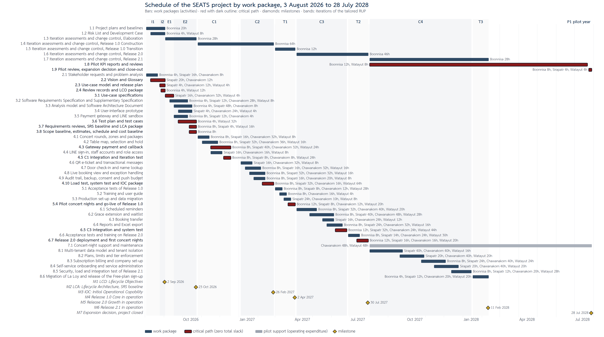

<!-- Source of the Milestone 2 "Part 2 Final Deliverables" PDF of course 2110722 Software Project Management.
     Merged on 15 Oct 2026 from the teammates' drafts (workspace/received/examples/teammate_milestone_2/*.docx:
     Review Decision Log, Final Deliverable, Generative AI Log) into the Milestone 1 format. Every table marked
     "plan:" is generated from tools/plan.py (WBS, hours, dates, cost, critical path) and regenerated on every build:
     edit the plan there, not the table here. The Review Board rows are the eight rows of the teammates' log with the
     section references re-pointed to this document; "six workstreams" in rows 3 and AI-03 became "workstreams"
     because the merged WBS has eight level-2 items. The project is named SEATS (Milestone 1 said CTRS). -->

# Executive Summary

The Seating & Event Availability Tracking System (SEATS, called CTRS in Milestone 1) is the software house's LINE-integrated reservation and check-in system, built first for La Loy Restaurant under a pilot implementation agreement and then productized as a subscription service. Milestone 1 set the business case, the charter (3 August 2026 to 28 July 2028, budget 1,010,590 THB) and a top-down estimate of 2,632 engineer hours. This Milestone 2 report turns that charter into the planning baselines of the project: the scope baseline (scope statement, WBS and WBS dictionary), the effort and resource plan, the cost baseline and the schedule baseline.

- **Scope.** Three releases, 1.0 Core (features F1 to F28), 2.0 Growth (F29 to F35) and 2.1 Product (multi-tenant productization), with the exclusions F36, F37 and configurable business rules, the deliverables of the tailored RUP and the seven success criteria of the charter.
- **WBS and effort.** 49 work packages in eight branches, each with one accountable engineer, bottom-up hours per engineer and three-point estimates for the four risky packages; the bottom-up total is the 2,632 hours of Milestone 1, re-allocated within its phase totals so that the budget of the charter holds.
- **Resources and cost.** The four part-time engineers at 300 and 350 THB an hour, the test devices, hosting, domain and legal set-up; labor 846,600 THB, other costs 75,500 THB, contingency reserve 88,490 THB tied to the risks of Milestone 1; cost baseline and project budget 1,010,590 THB, no management reserve; time-phased by iteration.
- **Schedule.** 49 activities in the ten iterations plus the pilot year and close-out, with predecessors, resource units and seven milestones; the critical path runs through every iteration up to Release 2.0 and then through the pilot year to the expansion decision on 28 July 2028; the productization branch (C4, T3) has 115 working days of total slack.

# Document Revision History

| Version | Date | Description | Author |
|---|---|---|---|
| 1.0 | 10 September 2026 | Milestone 1: Review Board Decision Log, business case, financial analysis, project charter, project organization chart (project then named CTRS) | SE69 Group 1 |
| 2.0 | 15 October 2026 | Milestone 2: Review Board Decision Log, project scope statement, WBS and tasks, effort estimation, resource assignment and rates, cost estimate, schedule with Gantt chart and critical path; project renamed SEATS | SE69 Group 1 |

# 1. Review Board Decision Log

The four members hold one Review Board meeting per artifact set, after each member's prompting session for the Milestone 2 deliverables. Every artifact is reviewed against the three criteria of the brief, Requirement Satisfaction, PMBOK Correctness and Project Consistency (with the Milestone 1 report and with the other Milestone 2 artifacts), and the board keeps the role separation of the tailored RUP: each artifact has exactly one accountable owner and the reviewer is never the author. Table 1.1 records one row per artifact or artifact part with the board's suggestion and decision; the prompt design, review and revision of each artifact are documented in the GenAI Log file (Part 1), and every prompt draws on the same single source of truth, the Milestone 1 report (dates, release scope, rates, phase effort and budget).

*Table 1.1 Review Board Decision Log, Milestone 2*

| No. | Artifact | Member (prompt design) | Suggestion from team (in brief) | Decision (Accept / Revise / Reject) |
|---|---|---|---|---|
| 1 | Scope statement and deliverables (Section 2) | Boonnisa T. | The draft mixed project-management, product and closure deliverables and did not list exclusions. Separate the deliverable categories, state the exclusions and retain the release boundaries. | Revise |
| 2 | Success criteria and budget baseline (Sections 2.5 and 6) | Boonnisa T. | Success measures needed numeric targets and evidence. Use the source targets (booking within 3 minutes, no-show reduction of 35 %, at least 5 transactions a second, response within 2 seconds, check-in within 15 seconds per table, recovery within 2 hours) and keep the budget at 1,010,590 THB. | Accept |
| 3 | WBS and schedule structure (Sections 3 and 7) | Sirapatr C. | The first WBS was phase-based with verb-action labels and no schedule columns. Re-decompose the workstreams to two levels with deliverable-oriented noun phrases and add WBS ID, task, responsible role, duration, predecessors, start, finish and expected output, preserving the iteration dates of Milestone 1. | Revise |
| 4 | Milestones and critical path (Sections 7.2 and 7.3) | Sirapatr C. | Milestone 1 gives iteration dates but no formally calculated critical path. Derive the chain with the standard float formulas (TS = LS − ES = LF − EF), show the zero-slack path, keep the productization branch as parallel work with float, and qualify the result as a planning analysis. | Accept |
| 5 | Effort estimation for tasks (Section 4) | Chawanakorn S. | The C1 payment-gateway effort was too low against the Milestone 1 baseline and the basis of estimates was missing. Reconcile the work-package allocations to 2,632 hours and 846,600 THB (0 % variance), state the basis of estimates and use three-point / PERT for the gateway, LINE and load-test items. | Revise |
| 6 | WBS decomposition and features by release (Section 3) | Chawanakorn S. | Core, Growth and productization features were mixed and some items were listed by page. Cover every feature F1 to F35 and the C4 / T3 productization exactly once, use noun-form work packages and one numbering scheme across all tables. | Revise |
| 7 | Quality requirements and tests (Sections 2.2 and 2.5) | Watayut A. | Quality requirements lacked verification methods. Map response time, throughput, check-in, recovery, backup and browser compatibility to test evidence with measurable thresholds. | Revise |
| 8 | Cost estimate consistency (Section 6) | Watayut A. | The budget needed transparent categories, exclusions and a final arithmetic check. Preserve the reported figures (Year 0 767,690; Year 1 242,900; total 1,010,590; labor 846,600; pilot fee 150,000; net 860,590) and flag the reconciliation for team verification. | Accept |

Artifacts marked Revise were revised as suggested before submission, and the sections of this document are the revised versions; every revision is recorded in the Review and Revision fields of the artifact's GenAI Log record (Part 1), and every artifact was accepted by the board into the project baseline after its revision.

# 2. Project Scope Statement

## 2.1 Project Summary

SEATS is a LINE-integrated web application for reserving tables at La Loy Restaurant's live-music concerts. Customers use a LIFF web application opened from the Rich Menu of the restaurant's LINE Official Account to browse concert rounds, view a live table map, select a table, hold it for 15 minutes, pay the full table fee through a payment gateway and receive a QR e-ticket. Restaurant staff use a shared back-office to manage rounds, layouts and prices, watch the live booking view, handle exceptions and scan QR codes at the door. One central record replaces the chat, the hand-edited image and the notebook, so that double bookings and payment disputes disappear and the Manager handles exceptions only. After the build, the system is run through a pilot year at La Loy and productized as a multi-tenant subscription service for other live-music restaurants.

The project runs from 3 August 2026 to 28 July 2028 (two project years) under the tailored Rational Unified Process of the Development Case: Year 0 builds and deploys Release 1.0 Core (in operation 2 April 2027) and Release 2.0 Growth (30 July 2027); Year 1 runs the live pilot and delivers Release 2.1 Product (11 February 2028), and closes with the expansion decision of the software house on 28 July 2028. The project budget is 1,010,590 THB (charter, Table 4.1 of Milestone 1), of which La Loy's pilot implementation fee covers 150,000 THB. The scope statement, the WBS of Section 3 and the WBS dictionary of Section 3.3 form the scope baseline; changes to it go through the Change Control Board.

## 2.2 Product Characteristics and Requirements

The product scope is the feature set of the Vision (Tables 2.15 to 2.18 of Milestone 1), grouped by release and user role in Table 2.1; the detailed requirements are the use-case specifications, the Software Requirements Specification and the Supplementary Specification of the Requirements Engineering project. The quality characteristics (Table 2.2) are the preliminary quality targets of Milestone 1 (Table 2.19), each now tied to the test that verifies it, as the Review Board asked (Table 1.1, row 7). Personal data is handled under the Personal Data Protection Act, with consent, retention and correction designed in; drink packages are presented within the Alcoholic Beverage Control Act.

*Table 2.1 Product scope by release and role*

| Release | Role | Features | Characteristics |
|---|---|---|---|
| 1.0 Core | Customer | F1 LINE sign-in, F2 table map, F3 table selection and 15-minute hold, F4 gateway payment, F5 QR e-ticket, F6 transactional messages, F7 booking terms, F8 my bookings, F9 round list | Self-service booking inside LINE: browse, choose, hold, pay the full fee, keep the e-ticket; no Manager reply needed |
| 1.0 Core | Manager (Owner read-only) | F10 concert rounds, F11 zones and packages, F12 live booking view, F13 ticket escalation management, F14 manual booking and payment overrides | Set up each concert round and watch every table, hold, payment and check-in on one live screen; exceptions by hand, including the degraded payment mode |
| 1.0 Core | Front Staff | F15 QR scan, F16 ticket details, F17 on-site check-in, F18 invalid-ticket escalation, F19 no-show and table release, F20 name lookup | Check-in by QR within 15 seconds per table; release of no-show tables after the grace period |
| 1.0 Core | System | F21 hold release, F22 daily backup, F23 payment callback, F24 staff accounts, F25 audit trail, F26 push-message budget, F27 degraded-mode switch, F28 consent and profile access | First-lock-wins hold with timeout, automatic confirmation on the gateway's webhook, role-based access, audit trail, backup with Excel export, consent |
| 2.0 Growth | Customer and System | F29 grace extension, F30 waitlist, F31 booking transfer, F32 scheduled reminders, F34 reminder scheduling, F35 waitlist offer | Use the central record to lose fewer tables: reminders, grace extension, waitlist in queue order, official transfer |
| 2.0 Growth | Manager and Owner | F33 reports | Booking, revenue, artist-popularity and customer-history reports with export |
| 2.1 Product | Software house | Multi-tenant data model and tenant isolation; Free, Standard and Premium plans with limits and enforcement; subscription billing and setup-fee invoicing; self-service onboarding; service administration; migration of La Loy | The pilot system productized as a subscription service within the 1,000 THB a month ceiling (Section 3.1 of Milestone 1) |

*Table 2.2 Quality requirements and their verification*

| Quality requirement | Target (Table 2.19 of Milestone 1) | Verification (test evidence) | When |
|---|---|---|---|
| Throughput at booking-open time | at least 5 transactions a second | Load test with simulated customers opening a round: 5 transactions a second sustained for 10 minutes, one hold per table, no deadlock (WBS 4.10) | before IOC; repeated for Release 2.1 (8.5) |
| Response time | within 2 seconds for customer and Front Staff transactions | Response-time measurement during the load test and in the acceptance tests on the test devices inside LINE (4.10, 5.1) | IOC, T1 |
| Check-in time | within 15 seconds per table | Timed check-in of 30 tickets by the Front Staff with the tablet at a pilot night (5.1, 5.4) | T1 |
| Recovery after an outage | within 2 hours during opening hours | Restore drill: restore the daily backup to a fresh environment and bring the service up within 2 hours (4.10, repeated in 8.5) | IOC, C4 |
| Backup and export | daily backup of booking data with export to Excel | Backup job verified daily in the test environment; the Excel export opened by the Manager (4.9, 5.1) | C2, T1 |
| Supported browsers | current LINE in-app browser; last two versions of Chrome, Safari and Edge | Browser-compatibility checklist run on the test devices and the shop's desktop browser (4.10, 5.1) | IOC, T1 |
| Operating cost of the restaurant | hosting, APIs and LINE plan at or below 1,000 THB a month | Monthly cost review of hosting and push messages during the pilot year (1.8) | P1 |

## 2.3 Project Deliverables

*Table 2.3 Project deliverables*

| Category | Deliverables |
|---|---|
| Project-management deliverables | Business case with financial analysis, project charter, stakeholder list and project organization (Milestone 1); scope statement, WBS and WBS dictionary, effort, resource and cost estimates, schedule and cost baseline (this document); quality, risk and communication management plans (Milestone 3); Development Case and Software Development Plan; iteration plan and assessment of every iteration; weekly status assessments; change-request decisions of the Change Control Board; Risk List updates; milestone reviews (LCO, LCA, IOC, Product Release 1.0, 2.0 and 2.1); monthly pilot KPI reports; pilot review, expansion decision record, hand-over record, lessons learned and sign-off |
| Product-related deliverables | Requirements and design artifacts of the tailored RUP: Vision, Glossary, Stakeholder Requests, Business Rules, Domain Model, Use-Case Model and use-case specifications, Software Requirements Specification, Supplementary Specification, Analysis Model, Software Architecture Document, user-interface prototype, test plan and test cases; the tested increment of every Construction iteration; Release 1.0 Core in operation at La Loy (2 April 2027), Release 2.0 Growth (30 July 2027) and the productized Release 2.1 (11 February 2028); load-test, system-test and acceptance records; training and user guide for the Manager and the Front Staff; migration of the current bookings and, in Release 2.1, of La Loy to the productized service; production environment, support routine and Free-plan sign-up |

## 2.4 Exclusions

- Split payment among the members of a party (F36) and table photos with distance to the stage (F37): Future candidates outside the project (Table 2.13 of Milestone 1).
- Restaurant-configurable booking rules beyond the rules agreed for the defined releases (hold, grace, transfer cut-off, waitlist, refund policy are fixed by the Owner's decisions before LCA).
- Payment-gateway fees, each restaurant's LINE Official Account plan and the pilot restaurant's own check-in tablet (about 9,000 THB): paid by the restaurant (CON-03, CON-07), not by the project budget.
- Sales, onboarding and operation of the subscription service for other restaurants after the expansion decision (Years 2 to 5 of the financial analysis): outside the project.
- Hardware at the venue beyond the test devices of the software house; any change to the restaurant's own LINE Official Account content.

## 2.5 Project Success Criteria

The success criteria are the seven criteria of the charter (Table 4.1 of Milestone 1), each with the evidence that shows it is met (Table 2.4). They are also the acceptance criteria of the major deliverables: Release 1.0 is accepted when criteria 2, 3, 5 and 6 are shown on the pilot nights of T1; Release 2.0 when the acceptance tests of F29 to F35 pass; Release 2.1 when La Loy runs on the productized service and the per-shop cost assumption holds.

*Table 2.4 Success criteria and evidence*

| No. | Success criterion (charter) | Target / evidence |
|---|---|---|
| 1 | Release milestones within budget | Release 1.0 Core in operation at La Loy on 2 April 2027, Release 2.0 Growth on 30 July 2027, Release 2.1 on 11 February 2028; cost at close-out within the project budget of 1,010,590 THB (go-live records, iteration assessments, cost baseline of Section 6) |
| 2 | Booking integrity | Zero double bookings on La Loy's concert nights after go-live; table status real-time on one record (audit trail and pilot KPI reports) |
| 3 | Customer experience | A booking completed within 3 minutes from table selection to confirmation, without a Manager reply (timestamps of the booking record; sample of pilot nights) |
| 4 | Business outcome | No-show rate at La Loy reduced by 35 % within six months of Release 2.0, against the baseline of Table 2.2 of Milestone 1 (check-in records versus bookings) |
| 5 | Operational quality and cost | Check-in within 15 seconds per table; at least 5 transactions a second at booking-open time; response within 2 seconds; recovery within 2 hours; the restaurant's hosting, APIs and LINE plan at or below 1,000 THB a month (Table 2.2 tests; monthly cost review) |
| 6 | Requirements and acceptance | Vision approved by the Owner at LCO, SRS signed off at LCA, acceptance tests of the two main use cases (reserve a concert table, check in with e-ticket) passed with the Manager and the Front Staff (milestone review and acceptance records) |
| 7 | Expansion gate | At the expansion decision: La Loy continues on a paid plan, at least 10 restaurants are on the waiting list, and the per-shop hosting and support cost of the productized service is at or below the assumptions of Table 3.3 of Milestone 1 (pilot review, waiting list, cost report) |

# 3. WBS and Tasks

## 3.1 Work Breakdown Structure and Activity List

The WBS (Table 3.1) is a deliverable-oriented decomposition of the total scope: level 1 is the project, level 2 the eight branches (project management, the phases of the tailored RUP by release, the pilot operation), level 3 the 49 work packages, named as nouns, each carried out by one activity (verb phrase). It follows the rules of the course: every unit of work appears in exactly one work package (100 % rule, checked for F1 to F35 and the Release 2.1 items), the work of a branch is the sum of its work packages, each work package has one accountable engineer (Table 4.1) and a WBS dictionary entry (Section 3.2), and the structure matches how the work is performed, by iteration. Project management is one branch that runs through all phases, so that status assessments, iteration assessments, change control, milestone reviews, pilot KPI reports and close-out are visible as work of their own. The pilot support of the restaurant (7.1) is work of the team but operating expenditure of Year 1 (Table 3.6 of Milestone 1), not development effort. Each activity has a duration in working days, a start and finish inside the iteration dates of Milestone 1 (Table 2.21 there), its predecessors (finish-to-start unless marked SS, start-to-start, or FF, finish-to-finish) and the engineers assigned with their units (PM Boonnisa T., SA Sirapatr C., RS Chawanakorn S., QA Watayut A.; 100 % is 8 hours a day); the seven milestones have zero duration and the dates of the charter. The calendar is Monday to Friday with the year-end break of 21 December 2026 to 1 January 2027; Thai public holidays are absorbed by the part-time allocation. Work packages are planned in detail up to Release 2.0; C4, T3 and the pilot year are planned at work-package level and will be detailed before C4 (rolling wave planning).

*Table 3.1 Work breakdown structure and activity list of the SEATS project*

<!-- plan: wbs_schedule -->

| WBS ID | Work package (iteration) | Activity | Days | Start | Finish | Predecessors | Resources (units) |
|---|---|---|---|---|---|---|---|
| **1** | **Project Management** |  |  |  |  |  |  |
| 1.1 | **Project plans and baselines** (I1, I2) | Produce the business case, the project charter, the organization, the Software Development Plan and the iteration plans I1 and I2 | 23 | 3 Aug 2026 | 2 Sep 2026 | — | PM 11 % |
| 1.2 | **Risk List and Development Case** (I1, I2) | Write the initial Risk List (RISK-01 to RISK-14) and the Development Case that tailors RUP for the project | 18 | 10 Aug 2026 | 2 Sep 2026 | 2.1 SS | PM 3 %, QA 6 % |
| 1.3 | **Iteration assessments and change control, Elaboration** (E1, E2) | Run the weekly status assessments, the E1 and E2 iteration assessments and the Change Control Board | 37 | 3 Sep 2026 | 23 Oct 2026 | 1.1 | PM 9 % |
| 1.4 | **Iteration assessments and change control, Release 1.0 Construction** (C1, C2) | Run the weekly status assessments, the C1 and C2 iteration assessments and the Change Control Board | 80 | 26 Oct 2026 | 26 Feb 2027 | 1.3 | PM 10 % |
| 1.5 | **Iteration assessments and change control, Release 1.0 Transition** (T1) | Run the weekly status assessments, the T1 assessment and the Change Control Board | 25 | 1 Mar 2027 | 2 Apr 2027 | 1.4 | PM 6 % |
| 1.6 | **Iteration assessments and change control, Release 2.0** (C3, T2) | Run the weekly status assessments, the C3 and T2 iteration assessments and the Change Control Board | 85 | 5 Apr 2027 | 30 Jul 2027 | 1.5 | PM 7 % |
| 1.7 | **Iteration assessments and change control, Release 2.1** (C4, T3) | Run the status assessments, the C4 and T3 iteration assessments and the Change Control Board | 140 | 2 Aug 2027 | 11 Feb 2028 | 1.6 | PM 2 % |
| 1.8 | **Pilot KPI reports and reviews** (P1) | Collect the pilot KPIs of every concert night (booking time, double bookings, no-shows, check-in time, operating cost) and review them monthly with the Owner | 255 | 2 Aug 2027 | 21 Jul 2028 | 6.7 | PM 1 %, QA 0 % |
| 1.9 | **Pilot review, expansion decision and close-out** (CL) | Review the pilot year against the success criteria of the charter, prepare the expansion decision, record lessons learned and obtain sign-off | 5 | 24 Jul 2028 | 28 Jul 2028 | 1.8 FF, 8.6 | PM 20 %, SA 10 %, QA 10 % |
| **2** | **Inception (I1, I2)** |  |  |  |  |  |  |
| 2.1 | **Stakeholder requests and problem analysis** (I1) | Interview the Owner and the Manager, observe concert nights, record the stakeholder requests, the problems and their root causes (5 Whys) | 15 | 3 Aug 2026 | 21 Aug 2026 | — | PM 3 %, SA 13 %, RS 7 % |
| 2.2 | **Vision and Glossary** (I1, I2) | Write the Vision (problem statement, stakeholders, features F1 to F37 with value, cost and priority) and the Glossary | 18 | 10 Aug 2026 | 2 Sep 2026 | 2.1 SS | SA 14 %, RS 8 % |
| 2.3 | **Use-case model and release plan** (I2) | Outline the use-case model and assign the features to Release 1.0, Release 2.0 and Future | 7 | 25 Aug 2026 | 2 Sep 2026 | 2.2 SS | SA 7 %, RS 21 %, QA 7 % |
| 2.4 | **Review records and LCO package** (I2) | Review the Inception artifacts against the RUP checkpoints, record the Review Records and assemble the LCO review | 5 | 27 Aug 2026 | 2 Sep 2026 | 2.2 SS, 2.3 SS | PM 10 %, QA 30 % |
| **3** | **Elaboration (E1, E2)** |  |  |  |  |  |  |
| 3.1 | **Use-case specifications** (E1) | Specify the two main use cases, Reserve a concert table and Check in with e-ticket, with the Manager and the Front Staff | 10 | 3 Sep 2026 | 16 Sep 2026 | 2.4 | SA 20 %, RS 40 %, QA 5 % |
| 3.2 | **Software Requirements Specification and Supplementary Specification** (E1, E2) | Write the SRS and the Supplementary Specification with the quality targets of Table 2.19 of Milestone 1 | 22 | 10 Sep 2026 | 9 Oct 2026 | 3.1 SS | PM 2 %, SA 7 %, RS 16 %, QA 5 % |
| 3.3 | **Analysis model and Software Architecture Document** (E2) | Produce the analysis model and the Software Architecture Document (LIFF front end, back office, application server, central database, LINE and gateway integration) | 22 | 17 Sep 2026 | 16 Oct 2026 | 3.1 | PM 2 %, SA 27 %, RS 5 % |
| 3.4 | **User-interface prototype** (E2) | Prototype the customer and back-office screens and have the Manager, the Front Staff and sample customers try them | 17 | 24 Sep 2026 | 16 Oct 2026 | 3.1 | SA 3 %, RS 18 %, QA 3 % |
| 3.5 | **Payment gateway and LINE sandbox** (E2) | Open the gateway sandbox and the LINE Developers channel, verify the merchant onboarding and the LIFF and Messaging API settings (RISK-03, external dependency) | 17 | 17 Sep 2026 | 9 Oct 2026 | 2.4 | PM 6 %, SA 9 %, RS 3 % |
| 3.6 | **Test plan and test cases** (E2) | Write the test plan and the test cases of the two main use cases, including the load-test design for 5 transactions a second (RISK-05) | 22 | 24 Sep 2026 | 23 Oct 2026 | 3.1 | PM 2 %, QA 18 % |
| 3.7 | **Requirements reviews, SRS baseline and LCA package** (E2) | Review the SRS, the SAD, the prototype and the test plan against the checkpoints, baseline the SRS and assemble the LCA review | 10 | 12 Oct 2026 | 23 Oct 2026 | 3.2, 3.3 SS, 3.4 SS, 3.6 SS | PM 10 %, SA 5 %, QA 20 % |
| 3.8 | **Scope baseline, estimates, schedule and cost baseline** (E2) | Produce the scope statement, the WBS and dictionary, the effort, resource and cost estimates, the schedule and cost baseline (this document) and the Construction plan | 10 | 12 Oct 2026 | 23 Oct 2026 | 3.2 SS | PM 10 % |
| **4** | **Release 1.0 Core: Construction (C1, C2)** |  |  |  |  |  |  |
| 4.1 | **Concert rounds, zones and packages** (C1) | Design, implement and unit-test the management of concert rounds, zones, table types, packages and prices | 15 | 26 Oct 2026 | 13 Nov 2026 | 3.7 | PM 7 %, SA 13 %, RS 27 %, QA 7 % |
| 4.2 | **Table map, selection and hold** (C1) | Implement the round list, the real-time table map, the table selection with the 15-minute hold and the automatic hold release | 20 | 2 Nov 2026 | 27 Nov 2026 | 4.1 SS | PM 5 %, SA 20 %, RS 22 %, QA 10 % |
| 4.3 | **Gateway payment and callback** (C1) | Integrate the hosted checkout, the booking terms, the payment webhook and the automatic confirmation of the booking | 25 | 16 Nov 2026 | 18 Dec 2026 | 3.5, 4.2 SS | PM 4 %, SA 20 %, RS 16 %, QA 12 % |
| 4.4 | **LINE sign-in, staff accounts and role access** (C1) | Implement LINE Login, the back-office accounts and the role-based access of Manager, Front Staff and Owner | 15 | 16 Nov 2026 | 4 Dec 2026 | 3.7 | SA 13 %, RS 13 %, QA 7 % |
| 4.5 | **C1 integration and iteration test** (C1) | Integrate the C1 increment, run the iteration tests and the C1 assessment | 10 | 7 Dec 2026 | 18 Dec 2026 | 4.1, 4.2, 4.3 SS, 4.4 | PM 10 %, SA 10 %, RS 10 %, QA 30 % |
| 4.6 | **QR e-ticket and transactional messages** (C2) | Implement the QR e-ticket, the customer's booking list and the transactional LINE messages | 15 | 4 Jan 2027 | 22 Jan 2027 | 4.5 | SA 13 %, RS 27 %, QA 7 % |
| 4.7 | **Door check-in and name lookup** (C2) | Implement the QR scan, the ticket details, the check-in, the invalid-ticket escalation, the no-show release and the name lookup | 20 | 11 Jan 2027 | 5 Feb 2027 | 4.6 SS | PM 5 %, SA 10 %, RS 20 %, QA 10 % |
| 4.8 | **Live booking view and exception handling** (C2) | Implement the live booking view, the ticket escalation, the manual overrides and the degraded-mode switch | 20 | 18 Jan 2027 | 12 Feb 2027 | 4.6 | PM 5 %, SA 20 %, RS 20 %, QA 10 % |
| 4.9 | **Audit trail, backup, consent and push budget** (C2) | Implement the audit trail, the daily backup with Excel export, the consent and profile access and the push-message budget | 15 | 25 Jan 2027 | 12 Feb 2027 | 4.6 | PM 7 %, SA 13 %, RS 17 %, QA 7 % |
| 4.10 | **Load test, system test and IOC package** (C2) | Run the load test (5 transactions a second at booking-open time), the system test of Release 1.0 and assemble the IOC review | 15 | 8 Feb 2027 | 26 Feb 2027 | 4.7, 4.8, 4.9 | PM 7 %, SA 27 %, RS 13 %, QA 53 % |
| **5** | **Release 1.0 Core: Transition (T1)** |  |  |  |  |  |  |
| 5.1 | **Acceptance tests of Release 1.0** (T1) | Run the acceptance tests of the two main use cases with the Manager and the Front Staff | 10 | 1 Mar 2027 | 12 Mar 2027 | 4.10 | PM 10 %, SA 10 %, RS 15 %, QA 35 % |
| 5.2 | **Training and user guide** (T1) | Train the Manager and the Front Staff and hand over the user guide | 10 | 8 Mar 2027 | 19 Mar 2027 | 5.1 SS | PM 10 %, RS 20 %, QA 5 % |
| 5.3 | **Production set-up and data migration** (T1) | Set up the production hosting, the domain and the gateway merchant account of La Loy, and migrate the current bookings | 10 | 15 Mar 2027 | 26 Mar 2027 | 5.1 | SA 30 %, RS 12 %, QA 10 % |
| 5.4 | **Pilot concert nights and go-live of Release 1.0** (T1) | Support the first concert nights on site, fix the defects found and declare Release 1.0 in operation | 10 | 22 Mar 2027 | 2 Apr 2027 | 5.2, 5.3 | PM 15 %, SA 10 %, RS 15 %, QA 25 % |
| **6** | **Release 2.0 Growth (C3, T2)** |  |  |  |  |  |  |
| 6.1 | **Scheduled reminders** (C3) | Implement the reminder scheduling and the scheduled LINE reminders within the push-message budget | 25 | 5 Apr 2027 | 7 May 2027 | 5.4 | PM 4 %, SA 16 %, RS 20 %, QA 10 % |
| 6.2 | **Grace extension and waitlist** (C3) | Implement the grace extension, the waitlist and the waitlist offer (rules decided by the Owner, RISK-08) | 30 | 26 Apr 2027 | 4 Jun 2027 | 6.1 SS | PM 3 %, SA 17 %, RS 20 %, QA 12 % |
| 6.3 | **Booking transfer** (C3) | Implement the official transfer of a confirmed booking to another LINE account | 15 | 17 May 2027 | 4 Jun 2027 | 6.1 | SA 13 %, RS 20 %, QA 10 % |
| 6.4 | **Reports and Excel export** (C3) | Implement the booking, revenue, artist-popularity and customer-history reports with export to Excel | 20 | 24 May 2027 | 18 Jun 2027 | 6.1 | PM 5 %, SA 15 %, RS 20 %, QA 10 % |
| 6.5 | **C3 integration and system test** (C3) | Integrate Release 2.0, run the regression and system tests and the C3 assessment | 15 | 7 Jun 2027 | 25 Jun 2027 | 6.2, 6.3, 6.4 | PM 10 %, SA 27 %, RS 20 %, QA 37 % |
| 6.6 | **Acceptance tests and training on Release 2.0** (T2) | Run the acceptance tests of the new features with the Manager and train the staff on them | 15 | 28 Jun 2027 | 16 Jul 2027 | 6.5 | PM 7 %, SA 12 %, RS 20 %, QA 25 % |
| 6.7 | **Release 2.0 deployment and first concert nights** (T2) | Deploy Release 2.0, support the first concert nights and declare Release 2.0 in operation | 15 | 12 Jul 2027 | 30 Jul 2027 | 6.6 SS | PM 10 %, SA 13 %, RS 13 %, QA 17 % |
| **7** | **Pilot operation (P1)** |  |  |  |  |  |  |
| 7.1 | **Concert-night support and maintenance** (P1) | Support the pilot restaurant on concert nights (on-call engineer) and maintain the system: 8 hours a month, costed as operating expenditure of Year 1 in Milestone 1 (Table 3.6), outside the 2,632 development hours | 260 | 2 Aug 2027 | 28 Jul 2028 | 6.7 | RS 2 %, QA 2 % |
| **8** | **Release 2.1 Product (C4, T3)** |  |  |  |  |  |  |
| 8.1 | **Multi-tenant data model and tenant isolation** (C4) | Design and implement the multi-tenant data model, the tenant isolation and the migration path of La Loy's data | 40 | 2 Aug 2027 | 24 Sep 2027 | 6.7 | SA 12 %, RS 12 %, QA 5 % |
| 8.2 | **Plans, limits and tier enforcement** (C4) | Implement the Free, Standard and Premium plans, their limits and the automatic enforcement of the limits | 30 | 20 Sep 2027 | 29 Oct 2027 | 8.1 | SA 8 %, RS 17 %, QA 8 % |
| 8.3 | **Subscription billing and company set-up** (C4) | Implement the subscription billing and the setup-fee invoicing; register the company and publish the terms of service, privacy policy and data-processing agreement | 30 | 25 Oct 2027 | 3 Dec 2027 | 8.2 SS | PM 3 %, SA 10 %, RS 17 %, QA 10 % |
| 8.4 | **Self-service onboarding and service administration** (C4) | Implement the self-service onboarding of a restaurant (zone map, packages, gateway and LINE set-up) and the service administration console | 30 | 15 Nov 2027 | 24 Dec 2027 | 8.2 | SA 8 %, RS 17 %, QA 8 % |
| 8.5 | **Security, load and integration test of Release 2.1** (C4) | Run the multi-tenant security test, the load test and the system test of Release 2.1 and the C4 assessment | 25 | 13 Dec 2027 | 14 Jan 2028 | 8.3, 8.4 SS | PM 4 %, SA 6 %, RS 10 %, QA 14 % |
| 8.6 | **Migration of La Loy and release of the Free-plan sign-up** (T3) | Migrate La Loy to the productized service, release the Free-plan sign-up and hand over to the support routine | 20 | 17 Jan 2028 | 11 Feb 2028 | 8.5 | PM 2 %, SA 8 %, RS 12 %, QA 12 % |
| M1 | *LCO: Lifecycle Objectives* |  | 0 | 2 Sep 2026 | 2 Sep 2026 | 2.4 | — |
| M2 | *LCA: Lifecycle Architecture, SRS baseline* |  | 0 | 23 Oct 2026 | 23 Oct 2026 | 3.7 | — |
| M3 | *IOC: Initial Operational Capability* |  | 0 | 26 Feb 2027 | 26 Feb 2027 | 4.10 | — |
| M4 | *Release 1.0 Core in operation* |  | 0 | 2 Apr 2027 | 2 Apr 2027 | 5.4 | — |
| M5 | *Release 2.0 Growth in operation* |  | 0 | 30 Jul 2027 | 30 Jul 2027 | 6.7 | — |
| M6 | *Release 2.1 in operation* |  | 0 | 11 Feb 2028 | 11 Feb 2028 | 8.6 | — |
| M7 | *Expansion decision, project closed* |  | 0 | 28 Jul 2028 | 28 Jul 2028 | 1.9 | — |

<!-- /plan -->

## 3.2 WBS Dictionary

Every work package has a WBS dictionary entry with the fields of Table 3.2, kept in the project's planning file; the entry printed is the work package the Review Board found most critical, the payment gateway integration (RISK-03, RISK-06).

*Table 3.2 WBS dictionary entry of work package 4.3*

<!-- plan: dict_4_3 -->

| Field | WBS 4.3 Gateway payment and callback |
|---|---|
| WBS item number | 4.3 |
| WBS item name | Gateway payment and callback |
| Description | Integrate the hosted checkout, the booking terms, the payment webhook and the automatic confirmation of the booking. |
| Responsibility | Sirapatr Chalermwattanatrai (System Analyst, Software Architect), accountable; Boonnisa T., Chawanakorn S., Watayut A. contribute |
| Input | SRS and SAD baseline (3.7); sandbox and merchant account of 3.5; table hold of 4.2 |
| Output | Payment flow with automatic confirmation |
| Features / content | F4, F7, F23 |
| Effort | 104 h (Boonnisa T. 8, Sirapatr C. 40, Chawanakorn S. 32, Watayut A. 24); method: three-point, O/M/P 80/100/150 h, PERT 105.0 h |
| Duration | 25 working days, 16 Nov 2026 to 18 Dec 2026 |
| Predecessors | 3.5, 4.2 SS |
| Labor cost | 33,600 THB |
| Acceptance criteria | A sandbox payment of the full table fee confirms the booking automatically within 10 seconds of the gateway's webhook; a timed-out hold rejects the payment; the webhook signature is verified; the degraded-mode switch (4.8) takes over when the gateway does not answer |

<!-- /plan -->

# 4. Effort Estimation

## 4.1 Basis of Estimates

Effort is estimated in person-hours per work package, bottom-up, by the engineer who will do the work and reviewed by the Quality Assurance role; duration is derived from the effort and the engineer's part-time availability, not the other way round. The assumptions are those of Milestone 1: the four engineers work part-time at the hours a week per phase of Table 3.4 of Milestone 1 (for example 16 hours a week for the Requirements Specifier in Construction), at the software house's internal cost rates of 300 and 350 THB an hour; a working week has five days of 8 hours. Two techniques are used and compared, as the course asks: the bottom-up estimate per work package (Table 4.1, with three-point estimates for the four risky packages, Table 4.2) and the top-down estimate per phase of Milestone 1 (Table 4.3). The Review Board decided (Table 1.1, row 5) to allocate the bottom-up hours within the phase totals of Milestone 1, so that the labor cost stays at 846,600 THB and the cost baseline at the budget of the charter; the estimate therefore moves from the budgetary accuracy of Milestone 1 (−10 % to +25 %) toward a definitive estimate (−5 % to +10 %) for the iterations up to Release 2.0, while C4 and T3 remain at budgetary accuracy until they are detailed before C4.

## 4.2 Bottom-up Estimate per Work Package

Table 4.1 gives the accountable engineer, the hours of each engineer and the labor cost of every work package at the rates of Table 5.1 (the packages estimated three-point, Table 4.2, are starred); it is also the assignment of the human resources to the work packages (Section 5.2). The 96 hours of concert-night support (7.1) are shown for completeness but are operating expenditure (28,800 THB in Table 3.6 of Milestone 1), outside the 2,632 development hours.

*Table 4.1 Effort and assignment per work package and engineer*

<!-- plan: effort -->

| WBS ID | Work package (\* three-point, Table 4.2) | Accountable | Boonnisa T. (PM) | Sirapatr C. (SA) | Chawanakorn S. (RS) | Watayut A. (QA) | Hours | Labor (THB) |
|---|---|---|---|---|---|---|---|---|
| **1** | **Project Management** |  |  |  |  |  |  |  |
| 1.1 | Project plans and baselines | Boonnisa T. | 20 | - | - | - | 20 | 7,000 |
| 1.2 | Risk List and Development Case | Watayut A. | 4 | - | - | 8 | 12 | 3,800 |
| 1.3 | Iteration assessments and change control, Elaboration | Boonnisa T. | 28 | - | - | - | 28 | 9,800 |
| 1.4 | Iteration assessments and change control, Release 1.0 Construction | Boonnisa T. | 64 | - | - | - | 64 | 22,400 |
| 1.5 | Iteration assessments and change control, Release 1.0 Transition | Boonnisa T. | 12 | - | - | - | 12 | 4,200 |
| 1.6 | Iteration assessments and change control, Release 2.0 | Boonnisa T. | 46 | - | - | - | 46 | 16,100 |
| 1.7 | Iteration assessments and change control, Release 2.1 | Boonnisa T. | 28 | - | - | - | 28 | 9,800 |
| 1.8 | Pilot KPI reports and reviews | Boonnisa T. | 12 | - | - | 8 | 20 | 6,600 |
| 1.9 | Pilot review, expansion decision and close-out | Boonnisa T. | 8 | 4 | - | 4 | 16 | 5,400 |
| **2** | **Inception (I1, I2)** |  |  |  |  |  |  |  |
| 2.1 | Stakeholder requests and problem analysis | Sirapatr C. | 4 | 16 | 8 | - | 28 | 9,400 |
| 2.2 | Vision and Glossary | Sirapatr C. | - | 20 | 12 | - | 32 | 10,600 |
| 2.3 | Use-case model and release plan | Chawanakorn S. | - | 4 | 12 | 4 | 20 | 6,200 |
| 2.4 | Review records and LCO package | Watayut A. | 4 | - | - | 12 | 16 | 5,000 |
| **3** | **Elaboration (E1, E2)** |  |  |  |  |  |  |  |
| 3.1 | Use-case specifications | Chawanakorn S. | - | 16 | 32 | 4 | 52 | 16,400 |
| 3.2 | Software Requirements Specification and Supplementary Specification | Chawanakorn S. | 4 | 12 | 28 | 8 | 52 | 16,400 |
| 3.3 | Analysis model and Software Architecture Document | Sirapatr C. | 4 | 48 | 8 | - | 60 | 20,600 |
| 3.4 | User-interface prototype | Chawanakorn S. | - | 4 | 24 | 4 | 32 | 9,800 |
| 3.5 | Payment gateway and LINE sandbox | Sirapatr C. | 8 | 12 | 4 | - | 24 | 8,200 |
| 3.6 | Test plan and test cases | Watayut A. | 4 | - | - | 32 | 36 | 11,000 |
| 3.7 | Requirements reviews, SRS baseline and LCA package | Watayut A. | 8 | 4 | - | 16 | 28 | 9,000 |
| 3.8 | Scope baseline, estimates, schedule and cost baseline | Boonnisa T. | 8 | - | - | - | 8 | 2,800 |
| **4** | **Release 1.0 Core: Construction (C1, C2)** |  |  |  |  |  |  |  |
| 4.1 | Concert rounds, zones and packages | Chawanakorn S. | 8 | 16 | 32 | 8 | 64 | 20,400 |
| 4.2 | Table map, selection and hold | Sirapatr C. | 8 | 32 | 36 | 16 | 92 | 29,600 |
| 4.3 | Gateway payment and callback \* | Sirapatr C. | 8 | 40 | 32 | 24 | 104 | 33,600 |
| 4.4 | LINE sign-in, staff accounts and role access | Chawanakorn S. | - | 16 | 16 | 8 | 40 | 12,800 |
| 4.5 | C1 integration and iteration test | Watayut A. | 8 | 8 | 8 | 24 | 48 | 15,200 |
| 4.6 | QR e-ticket and transactional messages | Chawanakorn S. | - | 16 | 32 | 8 | 56 | 17,600 |
| 4.7 | Door check-in and name lookup | Chawanakorn S. | 8 | 16 | 32 | 16 | 72 | 22,800 |
| 4.8 | Live booking view and exception handling | Sirapatr C. | 8 | 32 | 32 | 16 | 88 | 28,400 |
| 4.9 | Audit trail, backup, consent and push budget | Chawanakorn S. | 8 | 16 | 20 | 8 | 52 | 16,800 |
| 4.10 | Load test, system test and IOC package \* | Watayut A. | 8 | 32 | 16 | 64 | 120 | 38,000 |
| **5** | **Release 1.0 Core: Transition (T1)** |  |  |  |  |  |  |  |
| 5.1 | Acceptance tests of Release 1.0 | Watayut A. | 8 | 8 | 12 | 28 | 56 | 17,600 |
| 5.2 | Training and user guide | Chawanakorn S. | 8 | - | 16 | 4 | 28 | 8,800 |
| 5.3 | Production set-up and data migration | Sirapatr C. | - | 24 | 10 | 8 | 42 | 13,800 |
| 5.4 | Pilot concert nights and go-live of Release 1.0 | Boonnisa T. | 12 | 8 | 12 | 20 | 52 | 16,600 |
| **6** | **Release 2.0 Growth (C3, T2)** |  |  |  |  |  |  |  |
| 6.1 | Scheduled reminders \* | Chawanakorn S. | 8 | 32 | 40 | 20 | 100 | 32,000 |
| 6.2 | Grace extension and waitlist | Sirapatr C. | 8 | 40 | 48 | 28 | 124 | 39,600 |
| 6.3 | Booking transfer | Chawanakorn S. | - | 16 | 24 | 12 | 52 | 16,400 |
| 6.4 | Reports and Excel export | Chawanakorn S. | 8 | 24 | 32 | 16 | 80 | 25,600 |
| 6.5 | C3 integration and system test | Watayut A. | 12 | 32 | 24 | 44 | 112 | 35,800 |
| 6.6 | Acceptance tests and training on Release 2.0 | Watayut A. | 8 | 14 | 24 | 30 | 76 | 23,900 |
| 6.7 | Release 2.0 deployment and first concert nights | Boonnisa T. | 12 | 16 | 16 | 20 | 64 | 20,600 |
| **7** | **Pilot operation (P1)** |  |  |  |  |  |  |  |
| 7.1 | Concert-night support and maintenance (operating expenditure, outside the 2,632 h) | Watayut A. | - | - | 48 | 48 | 96 | 28,800 |
| **8** | **Release 2.1 Product (C4, T3)** |  |  |  |  |  |  |  |
| 8.1 | Multi-tenant data model and tenant isolation \* | Sirapatr C. | - | 40 | 40 | 16 | 96 | 30,800 |
| 8.2 | Plans, limits and tier enforcement | Chawanakorn S. | - | 20 | 40 | 20 | 80 | 25,000 |
| 8.3 | Subscription billing and company set-up | Chawanakorn S. | 8 | 24 | 40 | 24 | 96 | 30,400 |
| 8.4 | Self-service onboarding and service administration | Chawanakorn S. | - | 20 | 40 | 20 | 80 | 25,000 |
| 8.5 | Security, load and integration test of Release 2.1 | Watayut A. | 8 | 12 | 20 | 28 | 68 | 21,400 |
| 8.6 | Migration of La Loy and release of the Free-plan sign-up | Sirapatr C. | 4 | 12 | 20 | 20 | 56 | 17,600 |
| **Total development effort** |  |  | **434** | **706** | **842** | **650** | **2632** | **846,600** |
| Rate (THB/h) |  |  | 350 | 350 | 300 | 300 |  |  |
| **Labor cost (THB)** |  |  | **151,900** | **247,100** | **252,600** | **195,000** |  | **846,600** |

<!-- /plan -->

## 4.3 Three-point Estimates of the Risky Work Packages

The four work packages that carry the technical risks of Milestone 1 (RISK-03 gateway onboarding, RISK-05 burst load, the LINE push quota of RISK-07, the multi-tenant architecture of Release 2.1) were estimated three-point by the engineers who will build them, with the PERT weighted average (O + 4M + P) / 6 (Table 4.2). The allocated hours are within 2.5 % of the PERT values; the gap between the most likely and the pessimistic values is why these packages are named in the contingency reserve (Section 6.2).

*Table 4.2 Three-point estimates and PERT weighted average*

<!-- plan: three_point -->

| WBS ID | Work package | Optimistic O (h) | Most likely M (h) | Pessimistic P (h) | PERT (O + 4M + P) / 6 | Allocated (h) | Allocated vs PERT |
|---|---|---|---|---|---|---|---|
| 4.3 | Gateway payment and callback | 80 | 100 | 150 | 105.0 | 104 | -1.0 % |
| 4.10 | Load test, system test and IOC package | 90 | 115 | 180 | 121.7 | 120 | -1.4 % |
| 6.1 | Scheduled reminders | 80 | 96 | 150 | 102.3 | 100 | -2.3 % |
| 8.1 | Multi-tenant data model and tenant isolation | 72 | 92 | 150 | 98.3 | 96 | -2.4 % |

<!-- /plan -->

## 4.4 Comparison with the Top-down Estimate of Milestone 1

Table 4.3 compares the bottom-up hours per phase and engineer with the top-down estimate of Milestone 1 (Table 3.4 there). The totals per engineer and per year are identical by the Review Board's decision; per phase the bottom-up plan differs in two places: the monthly pilot KPI reports and the close-out (1.8, 1.9, 36 hours) are drawn from the Release 2.1 pool, which Milestone 1 had no row for, and 3.5 hours of the Project Manager's control work move from C3 to T2 because work package 1.6 spans both iterations. The percent difference is below 8 % for every phase that has hours in both estimates and 0 % in total, which confirms the Milestone 1 figures as the planning baseline.

*Table 4.3 Bottom-up versus top-down effort by phase*

<!-- plan: effort_phase -->

| Phase | Boonnisa T. | Sirapatr C. | Chawanakorn S. | Watayut A. | Bottom-up (h) | Milestone 1 top-down (h) | Difference (h) | Percent difference |
|---|---|---|---|---|---|---|---|---|
| Inception (I1, I2) | 32 | 40 | 32 | 24 | 128 | 128 | +0 | 0.0 % |
| Elaboration (E1, E2) | 64 | 96 | 96 | 64 | 320 | 320 | +0 | 0.0 % |
| Construction Release 1.0 (C1, C2) | 128 | 224 | 256 | 192 | 800 | 800 | +0 | 0.0 % |
| Transition Release 1.0 (T1) | 40 | 40 | 50 | 60 | 190 | 190 | +0 | 0.0 % |
| Construction Release 2.0 (C3) | 68.4706 | 144 | 168 | 120 | 500.471 | 504 | -3.52941 | 0.7 % |
| Transition Release 2.0 (T2) | 33.5294 | 30 | 40 | 50 | 153.529 | 150 | +3.52941 | 2.3 % |
| Construction Release 2.1 (C4) | 40 | 116 | 180 | 108 | 444 | 480 | -36 | 7.8 % |
| Transition Release 2.1 (T3) | 8 | 12 | 20 | 20 | 60 | 60 | +0 | 0.0 % |
| Pilot operation and close-out (P1) | 20 | 4 | 0 | 12 | 36 | 0 | +36 | 200.0 % |
| **Total** | **434** | **706** | **842** | **650** | **2632** | **2632** | **+0** | **0.0 %** |

<!-- /plan -->

# 5. Human and Physical Resource Assignment and Rates

## 5.1 Resource Rates

Table 5.1 lists the human resources with their roles, cost rates and availability per phase (the hours a week of Table 3.4 of Milestone 1, which are the maximum units of each engineer in the schedule), and the physical resources (equipment, services, legal set-up) with their cost basis and the work packages that use them. Rates are per hour and identical to Milestone 1; items paid by the restaurant are listed so that they are not confused with project costs.

*Table 5.1 Resource rate table (human and physical resources)*

<!-- plan: rates -->

| Resource | Role / use | Type | Rate or cost basis | Availability (hours a week per phase) / when |
|---|---|---|---|---|
| Boonnisa Tangjitpermkwamdee | Project Manager, Change Control Manager | Work (human) | 350 THB/h | Inception 8; Elaboration 8; C 1.0 8; T 1.0 8; C 2.0 6; T 2.0 6; C 2.1 2.5; T 2.1 2 h/week |
| Sirapatr Chalermwattanatrai | System Analyst, Software Architect | Work (human) | 350 THB/h | Inception 10; Elaboration 12; C 1.0 14; T 1.0 8; C 2.0 12; T 2.0 6; C 2.1 5; T 2.1 3 h/week |
| Chawanakorn Sanannam | Requirements Specifier, User-Interface Designer, Designer / Implementer | Work (human) | 300 THB/h | Inception 8; Elaboration 12; C 1.0 16; T 1.0 10; C 2.0 14; T 2.0 8; C 2.1 7.5; T 2.1 5 h/week |
| Watayut Aiamanan | Quality Assurance, Test Designer / Tester, Implementer (Construction) | Work (human) | 300 THB/h | Inception 6; Elaboration 8; C 1.0 12; T 1.0 12; C 2.0 10; T 2.0 10; C 2.1 5; T 2.1 5 h/week |
| Android phone and 10-inch tablet | LIFF and check-in testing (4.2 to 4.10, 5.1, 6.5, 8.5) | Equipment (CAPEX) | 15,000 THB, one set | C1 |
| Development and staging hosting | Build and test environments (3.3 to 8.5) | Service | 300 THB a month, 12 months of Year 0 | I1 to T2 |
| Production hosting | Pilot restaurant's live system (5.3 onwards) | Service | 700 THB a month: 5 months of Year 0, 12 of Year 1 | T1 to P1 |
| Domain name and TLS certificate | Production set-up (5.3) | Service | 1,200 THB a year | T1 |
| Payment gateway sandbox, LINE Developers, GitHub, Figma, PlantUML | 3.5 onwards | Service | free tiers, 0 THB | E2 onwards |
| Company registration, terms of service, privacy policy, data-processing agreement | Subscription business (8.3) | Legal (Year 1) | 15,000 THB, once | C4 |
| Pilot restaurant's check-in tablet, LINE Official Account plan, gateway merchant account | Operation at La Loy | Customer-paid | paid by La Loy (CON-03, CON-07); about 9,000 THB for the tablet | T1 onwards |

<!-- /plan -->

## 5.2 Assignment of Resources to Work Packages

Human resources are assigned to the work packages in Table 4.1 (accountable engineer and hours of every engineer) and Table 3.1 (units per activity); physical resources are assigned in Table 5.1. Table 5.2 summarizes the assignment per branch as a responsibility assignment matrix in RACI form: A/R the engineer accountable for the listed work packages (who also works on them), R the other engineers assigned with hours, C the restaurant-side stakeholders and external parties consulted, I the parties kept informed through the iteration assessments. The matrix keeps the rules of Milestone 1: one owner per artifact, and the reviewer (Quality Assurance) is never the author of what it reviews.

*Table 5.2 Responsibility assignment matrix (RACI) by WBS branch*

<!-- plan: raci_branch -->

| WBS | Branch | Boonnisa T. (Project Manager) | Sirapatr C. (System Analyst) | Chawanakorn S. (Requirements Specifier) | Watayut A. (Quality Assurance) | Restaurant Owner | Manager / Front Staff | Other consulted |
|---|---|---|---|---|---|---|---|---|
| 1 | Project Management | A/R (1.1, 1.3, 1.4, 1.5, 1.6, 1.7, 1.8, 1.9) | R | I | A/R (1.2) | C | C | Sponsor (partners) |
| 2 | Inception (I1, I2) | R | A/R (2.1, 2.2) | A/R (2.3) | A/R (2.4) | C | C | - |
| 3 | Elaboration (E1, E2) | A/R (3.8) | A/R (3.3, 3.5) | A/R (3.1, 3.2, 3.4) | A/R (3.6, 3.7) | C | C | Customers, Gateway provider, LINE Platform, Sponsor (partners) |
| 4 | Release 1.0 Core: Construction (C1, C2) | R | A/R (4.2, 4.3, 4.8) | A/R (4.1, 4.4, 4.6, 4.7, 4.9) | A/R (4.5, 4.10) | I | C | Gateway provider |
| 5 | Release 1.0 Core: Transition (T1) | A/R (5.4) | A/R (5.3) | A/R (5.2) | A/R (5.1) | C | C | Gateway provider |
| 6 | Release 2.0 Growth (C3, T2) | A/R (6.7) | A/R (6.2) | A/R (6.1, 6.3, 6.4) | A/R (6.5, 6.6) | C | C | - |
| 7 | Pilot operation (P1) | I | I | R | A/R (7.1) | I | C | - |
| 8 | Release 2.1 Product (C4, T3) | R | A/R (8.1, 8.6) | A/R (8.2, 8.3, 8.4) | A/R (8.5) | C | C | Legal counsel, Sponsor (partners) |

<!-- /plan -->

## 5.3 Resource Loading and Leveling

Table 5.3 compares, per phase and engineer, the planned average hours a week with the availability of Milestone 1, and shows the peak week when the hours of each work package are spread evenly over its duration. The averages match the availability by construction. Peaks above it occur where several packages of one engineer overlap inside a Construction iteration; two were flattened by starting the test plan (3.6) and the Release 2.1 test (8.5) earlier, and the rest are leveled within the iteration by the engineer working the overlapping packages one after the other inside their free slack (every package but the last of an iteration has slack up to the iteration's test package), because the software house commits each engineer to the phase total of hours, not to a weekly cap. No leveling moves a milestone; if other client work makes a peak impossible, the response of RISK-02 applies and the priority-2 features of the iteration move to the next one.

*Table 5.3 Resource loading per phase: planned average and peak week against availability*

<!-- plan: load -->

| Phase | Weeks | Boonnisa T.: hours a week (planned avg, peak / available) | Sirapatr C.: hours a week (planned avg, peak / available) | Chawanakorn S.: hours a week (planned avg, peak / available) | Watayut A.: hours a week (planned avg, peak / available) |
|---|---|---|---|---|---|
| Inception (I1, I2) | 4 | 8.0 avg, 7 peak / 8 | 10.0 avg, 11 peak / 10 | 8.0 avg, 14 peak / 8 | 6.0 avg, 11 peak / 6 |
| Elaboration (E1, E2) | 8 | 8.0 avg, 14 peak / 8 | 12.0 avg, 18 peak / 12 | 12.0 avg, 19 peak / 12 | 8.0 avg, 16 peak / 8 |
| Construction Release 1.0 (C1, C2) | 16 | 8.0 avg, 11 peak / 8 | 14.0 avg, 24 peak / 14 | 16.0 avg, 27 peak / 16 | 12.0 avg, 28 peak / 12 |
| Transition Release 1.0 (T1) | 5 | 8.0 avg, 10 peak / 8 | 8.0 avg, 16 peak / 8 | 10.0 avg, 14 peak / 10 | 12.0 avg, 16 peak / 12 |
| Construction Release 2.0 (C3) | 12 | 5.7 avg, 9 peak / 6 | 12.0 avg, 18 peak / 12 | 14.0 avg, 24 peak / 14 | 10.0 avg, 19 peak / 10 |
| Transition Release 2.0 (T2) | 5 | 6.7 avg, 9 peak / 6 | 6.0 avg, 10 peak / 6 | 8.0 avg, 13 peak / 8 | 10.0 avg, 17 peak / 10 |
| Construction Release 2.1 (C4) | 24 | 1.7 avg, 3 peak / 2.5 | 4.8 avg, 8 peak / 5 | 7.5 avg, 13 peak / 7.5 | 4.5 avg, 9 peak / 5 |
| Transition Release 2.1 (T3) | 4 | 2.0 avg, 2 peak / 2 | 3.0 avg, 3 peak / 3 | 5.0 avg, 5 peak / 5 | 5.0 avg, 5 peak / 5 |

<!-- /plan -->

# 6. Cost Estimate

## 6.1 Cost by WBS Item

The cost baseline is built up from the work packages, as the PMBOK budget build-up prescribes: the labor of each work package is its hours times the rate of each assigned engineer (Table 4.1), the other costs are the physical resources of Table 5.1 attached to the work packages that use them, and the contingency reserve for the identified risks is added to form the cost baseline (Table 6.1). The totals equal the budget of the charter and the cost tables of Milestone 1 (Tables 2.20 and 3.7 there): labor 846,600 THB, other costs 75,500 THB (test devices 15,000, hosting and domain 8,300, legal set-up 15,000, pilot hosting 8,400, pilot support 28,800), contingency 88,490 THB.

*Table 6.1 Cost estimate by WBS item, contingency reserve, cost baseline and project budget*

<!-- plan: cost -->

| WBS | Item | Hours | Labor basis (hours x THB/h) | Labor (THB) | Other costs (THB) | Subtotal (THB) |
|---|---|---|---|---|---|---|
| 1 | Project Management | 246 | Boonnisa T. 222 h x 350; Sirapatr C. 4 h x 350; Watayut A. 20 h x 300 | 85,100 | - | 85,100 |
| 2 | Inception (I1, I2) | 96 | Boonnisa T. 8 h x 350; Sirapatr C. 40 h x 350; Chawanakorn S. 32 h x 300; Watayut A. 16 h x 300 | 31,200 | Development and staging hosting, August 2026 300 | 31,500 |
| 3 | Elaboration (E1, E2) | 292 | Boonnisa T. 36 h x 350; Sirapatr C. 96 h x 350; Chawanakorn S. 96 h x 300; Watayut A. 64 h x 300 | 94,200 | Development and staging hosting, September to October 2026 600 | 94,800 |
| 4 | Release 1.0 Core: Construction (C1, C2) | 736 | Boonnisa T. 64 h x 350; Sirapatr C. 224 h x 350; Chawanakorn S. 256 h x 300; Watayut A. 192 h x 300 | 235,200 | Test devices: Android phone and 10-inch tablet 15,000; Development and staging hosting, November 2026 to February 2027 1,200 | 251,400 |
| 5 | Release 1.0 Core: Transition (T1) | 178 | Boonnisa T. 28 h x 350; Sirapatr C. 40 h x 350; Chawanakorn S. 50 h x 300; Watayut A. 60 h x 300 | 56,800 | Domain name and TLS certificate 1,200; Development and staging hosting, March 2027 300; Production hosting of the pilot restaurant, March 2027 700 | 59,000 |
| 6 | Release 2.0 Growth (C3, T2) | 608 | Boonnisa T. 56 h x 350; Sirapatr C. 174 h x 350; Chawanakorn S. 208 h x 300; Watayut A. 170 h x 300 | 193,900 | Development and staging hosting, April to July 2027 1,200; Production hosting of the pilot restaurant, April to July 2027 2,800 | 197,900 |
| 7 | Pilot operation (P1) | 0 |  | 0 | Production hosting during the pilot year 8,400; support labor 96 h x 300 = 28,800 | 37,200 |
| 8 | Release 2.1 Product (C4, T3) | 476 | Boonnisa T. 20 h x 350; Sirapatr C. 128 h x 350; Chawanakorn S. 200 h x 300; Watayut A. 128 h x 300 | 150,200 | Company registration, terms of service, privacy policy and data-processing agreement 15,000 | 165,200 |
|  | **Work-package estimates** | **2632** |  | **846,600** | **75,500** | **922,100** |
|  | Contingency reserve, Year 0 (RISK-02, RISK-03, RISK-05, RISK-08, RISK-10) |  | 10 % of 697,900 THB |  |  | 69,790 |
|  | Contingency reserve, Year 1 (RISK-04, RISK-07, RISK-12) |  | 10 % of 187,000 THB (labor of C4 and T3 and the legal set-up) |  |  | 18,700 |
|  | **Cost baseline** |  |  |  |  | **1,010,590** |
|  | Management reserve |  | none held by the sponsor for this project (unknown unknowns escalate to the partners' meeting) |  |  | 0 |
|  | **Project budget (charter)** |  |  |  |  | **1,010,590** |
|  | Less: pilot implementation fee of La Loy (revenue inside the project) |  |  |  |  | (150,000) |
|  | **Net investment of the software house** |  |  |  |  | **860,590** |

<!-- /plan -->

## 6.2 Contingency Reserve and Management Reserve

The contingency reserve covers identified risks (known unknowns) and is part of the cost baseline. Year 0 holds 69,790 THB, 10 % of the Year 0 cost, for the risks that can lengthen the build: RISK-02 (part-time engineers delayed by other work, about 2 weeks of an iteration, 35,000 THB), RISK-03 (gateway onboarding or LINE settings late, a re-run of the gateway package, 20,000 THB), RISK-05 (burst load above design, an extra load-test and tuning cycle, 10,000 THB), RISK-08 and RISK-10 (late business rules and change requests after the SRS baseline, rework in C3, 5,000 THB). Year 1 holds 18,700 THB, 10 % of the productization labor and the legal set-up, for RISK-04 (support and productization competing for the same engineers), RISK-07 (push messages or hosting above the operating-cost ceiling) and RISK-12 (slower adoption, which may require a second pilot venue before the gate). The reserve is released by the Project Manager at an iteration assessment against a recorded risk event, never for new features. The sponsor holds no management reserve for this project: unknown unknowns are escalated to the partners' meeting of the software house, which decides on additional funds or a scope change through the Change Control Board; the project budget therefore equals the cost baseline, 1,010,590 THB.

## 6.3 Time-phased Cost Baseline

Table 6.2 phases the cost baseline over the iterations: the labor of each work package is spread evenly over its working days, the other costs fall in the iteration that uses them, and the contingency reserve of each year is distributed in proportion to the cost of the iterations of that year. The cumulative column is the S-curve against which cost performance is measured at every iteration assessment; the cumulative at the end of T2 is the 767,690 THB of the Year 0 budget.

*Table 6.2 Time-phased cost baseline by iteration*

<!-- plan: cost_phased -->

| Iteration | Name | Period | Labor (THB) | Other costs (THB) | Contingency (THB) | Subtotal (THB) | Cumulative (THB) |
|---|---|---|---|---|---|---|---|
| I1 | Inception I1 | 3 Aug 2026 to 24 Aug 2026 | 23,070 | 300 | 2,337 | 25,707 | 25,707 |
| I2 | Inception I2 | 25 Aug 2026 to 2 Sep 2026 | 18,930 | 0 | 1,893 | 20,823 | 46,530 |
| E1 | Elaboration E1 | 3 Sep 2026 to 16 Sep 2026 | 22,776 | 600 | 2,338 | 25,714 | 72,244 |
| E2 | Elaboration E2 | 17 Sep 2026 to 23 Oct 2026 | 81,224 | 0 | 8,122 | 89,346 | 161,590 |
| C1 | Construction C1 | 26 Oct 2026 to 18 Dec 2026 | 122,800 | 16,200 | 13,900 | 152,900 | 314,490 |
| C2 | Construction C2 | 4 Jan 2027 to 26 Feb 2027 | 134,800 | 0 | 13,480 | 148,280 | 462,770 |
| T1 | Transition T1 | 1 Mar 2027 to 2 Apr 2027 | 61,000 | 2,200 | 6,320 | 69,520 | 532,290 |
| C3 | Construction C3 | 5 Apr 2027 to 25 Jun 2027 | 160,765 | 0 | 16,076 | 176,841 | 709,131 |
| T2 | Transition T2 | 28 Jun 2027 to 30 Jul 2027 | 49,235 | 4,000 | 5,324 | 58,559 | 767,690 |
| P1 | Pilot year P1 | 2 Aug 2027 to 28 Jul 2028 | 6,600 | 37,200 | 3,653 | 47,453 | 815,143 |
| C4 | Construction C4 | 2 Aug 2027 to 14 Jan 2028 | 141,000 | 15,000 | 13,012 | 169,012 | 984,155 |
| T3 | Transition T3 | 17 Jan 2028 to 11 Feb 2028 | 19,000 | 0 | 1,585 | 20,585 | 1,004,740 |
| CL | Close-out | 24 Jul 2028 to 28 Jul 2028 | 5,400 | 0 | 450 | 5,850 | 1,010,590 |
|  | **Total** |  | **846,600** | **75,500** | **88,490** | **1,010,590** |  |

<!-- /plan -->

## 6.4 Reconciliation and Cost-control Rules

The bottom-up cost baseline reconciles with Milestone 1 without variance: 846,600 THB of labor for 2,632 hours, 75,500 THB of other costs, 88,490 THB of contingency, 1,010,590 THB in total, of which 767,690 THB in Year 0 and 242,900 THB in Year 1; less the pilot implementation fee of 150,000 THB, the net investment of the software house is 860,590 THB, as in the charter. The cost-control rules of the project are:

- The Project Manager tracks actual hours against the 2,632-hour plan and actual cost against the time-phased baseline at every iteration assessment; the control threshold is ±10 % of the cumulative baseline, above which a change request or a re-plan is raised.
- Any change that affects scope, budget or milestone dates is assessed for impact and decided by the Change Control Board; the baseline is re-planned, not silently extended (RISK-10).
- The contingency reserve is held for identified risks and released against a recorded risk event; it is not planned feature-development effort.
- The budget excludes the costs that Milestone 1 assigns to the restaurant: its LINE plan, the gateway's merchant fees and the check-in tablet.
- Figures are kept in 2026 THB, rounded to the nearest 10 THB in the tables and to the hour in the effort plan.

# 7. Schedule, Gantt Chart and Critical Path

## 7.1 Gantt Chart

Figure 7.1 is the Gantt chart of the schedule baseline: the 49 activities of Table 3.1 with their assigned hours, grouped by WBS branch over the iteration bands of the tailored RUP, with the seven milestones. The schedule keeps every iteration and milestone date of Milestone 1; the activities inside an iteration overlap by start-to-start links so that the engineers' part-time hours fit the iteration, and the test and integration package of every Construction iteration ends on the iteration's last day.

*Figure 7.1 Gantt chart of the SEATS project by work package, with iterations, milestones and critical path*

## 7.2 Critical Path

The critical path is calculated on the iteration network with the forward and backward pass in working days (Table 7.1): ES and EF from the predecessors, LS and LF from the project finish, total slack TS = LS − ES = LF − EF. The iterations are linked finish-to-start as the Development Case prescribes; the pilot year P1 and the productization branch C4, T3 both start after Release 2.0 is in operation, and the close-out follows T3 and finishes together with the pilot year (finish-to-finish), because the expansion decision needs both the pilot KPIs and the productized service. The project is 510 working days long. The zero-slack path is I1, I2, E1, E2, C1, C2, T1, C3, T2, P1 and the close-out: every iteration up to Release 2.0 is critical, because each starts when the previous one ends, and after Release 2.0 the pilot year drives the finish date, since its 260 working days of KPI measurement are longer than the 140 working days of C4 and T3. The productization branch has 115 working days of total slack, so a delay of Release 2.1 by up to 23 weeks would not move the expansion decision; a delay of any iteration up to T2, or a shorter pilot year, would. Within the critical iterations the critical work packages are those that end on the iteration's last day and feed the next iteration, marked red in Figure 7.1: the LCO package (2.4), the SRS baseline and LCA package (3.7), the gateway payment (4.3) and the C1 integration test (4.5), the load and system test before IOC (4.10), the go-live of Release 1.0 (5.4), the C3 integration test (6.5), the deployment of Release 2.0 (6.7), the pilot KPI reports (1.8) and the close-out (1.9). This is a planning analysis; if an iteration threatens its milestone, the responses are, in order, the re-planning of priority-2 features (RISK-02), fast-tracking the next iteration's design work in parallel with the current iteration's test package, and crashing by raising the engineers' hours a week within the contingency reserve.

*Table 7.1 Critical path method on the iteration network (working days from 3 August 2026)*

<!-- plan: cpm -->

| ID | Iteration | Duration (wd) | Predecessors | ES | EF | LS | LF | Total slack (wd) | Critical | Early start | Early finish |
|---|---|---|---|---|---|---|---|---|---|---|---|
| I1 | Inception I1 | 16 | — | 0 | 16 | 0 | 16 | 0 | Yes | 3 Aug 2026 | 24 Aug 2026 |
| I2 | Inception I2 | 7 | I1 | 16 | 23 | 16 | 23 | 0 | Yes | 25 Aug 2026 | 2 Sep 2026 |
| E1 | Elaboration E1 | 10 | I2 | 23 | 33 | 23 | 33 | 0 | Yes | 3 Sep 2026 | 16 Sep 2026 |
| E2 | Elaboration E2 | 27 | E1 | 33 | 60 | 33 | 60 | 0 | Yes | 17 Sep 2026 | 23 Oct 2026 |
| C1 | Construction C1 | 40 | E2 | 60 | 100 | 60 | 100 | 0 | Yes | 26 Oct 2026 | 18 Dec 2026 |
| C2 | Construction C2 | 40 | C1 | 100 | 140 | 100 | 140 | 0 | Yes | 4 Jan 2027 | 26 Feb 2027 |
| T1 | Transition T1 | 25 | C2 | 140 | 165 | 140 | 165 | 0 | Yes | 1 Mar 2027 | 2 Apr 2027 |
| C3 | Construction C3 | 60 | T1 | 165 | 225 | 165 | 225 | 0 | Yes | 5 Apr 2027 | 25 Jun 2027 |
| T2 | Transition T2 | 25 | C3 | 225 | 250 | 225 | 250 | 0 | Yes | 28 Jun 2027 | 30 Jul 2027 |
| P1 | Pilot year P1 | 260 | T2 | 250 | 510 | 250 | 510 | 0 | Yes | 2 Aug 2027 | 28 Jul 2028 |
| C4 | Construction C4 | 120 | T2 | 250 | 370 | 365 | 485 | 115 | No | 2 Aug 2027 | 14 Jan 2028 |
| T3 | Transition T3 | 20 | C4 | 370 | 390 | 485 | 505 | 115 | No | 17 Jan 2028 | 11 Feb 2028 |
| CL | Close-out | 5 | T3, P1 (FF) | 505 | 510 | 505 | 510 | 0 | Yes | 24 Jul 2028 | 28 Jul 2028 |

<!-- /plan -->

## 7.3 Milestone Control Points

*Table 7.2 Milestones and their acceptance decisions*

<!-- plan: milestones -->

| ID | Milestone | Date | After | Acceptance / decision |
|---|---|---|---|---|
| M1 | LCO: Lifecycle Objectives | 2 Sep 2026 | 2.4 | Vision approved by the Owner; Business Case, charter, Development Case and plans accepted; go for Elaboration |
| M2 | LCA: Lifecycle Architecture, SRS baseline | 23 Oct 2026 | 3.7 | SRS signed off by the Owner; architecture, prototype and test plan accepted; gateway and LINE prerequisites verified; financial analysis re-run; go for Construction |
| M3 | IOC: Initial Operational Capability | 26 Feb 2027 | 4.10 | Release 1.0 passes the system and load tests (5 transactions a second); go for the pilot on concert nights |
| M4 | Release 1.0 Core in operation | 2 Apr 2027 | 5.4 | Acceptance tests of the two main use cases passed with the Manager and Front Staff; data migrated; Release 1.0 declared in operation |
| M5 | Release 2.0 Growth in operation | 30 Jul 2027 | 6.7 | Acceptance tests of the Release 2.0 features passed; pilot year and KPI measurement begin |
| M6 | Release 2.1 in operation | 11 Feb 2028 | 8.6 | La Loy migrated to the productized service; Free-plan sign-up released; hand-over to the support routine |
| M7 | Expansion decision, project closed | 28 Jul 2028 | 1.9 | Pilot review against the seven success criteria of the charter; expansion decision of the software house; lessons learned; sign-off |

<!-- /plan -->
