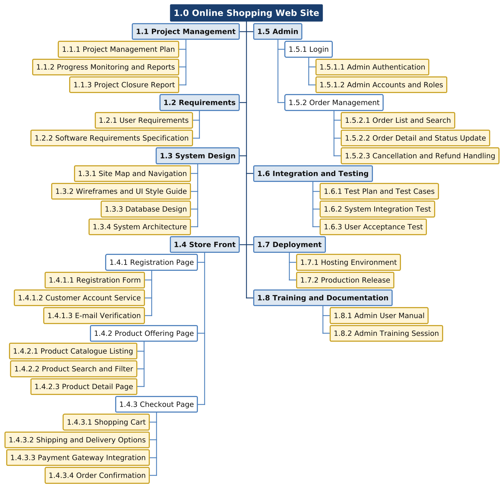

# Exercise 1: Scope management (WBS) and schedule management (activity list)

| | |
|---|---|
| Course | 2110722 Software Project Management, semester 1/2569 (Assoc. Prof. Dr. Twittie Senivongse) |
| Exercise | Exercise 1 (5 points): Scope management (WBS) and schedule management (activity list) |
| Student | Watayut Aiamanan, student ID 6970267821 |
| Project | Online shopping web site: Store front (Registration page, Product offering page, Checkout page) and Admin (Login, Order management) |

## Part 1: Work breakdown structure (WBS)

The WBS below is organised by **product** (deliverable-oriented, like the intranet WBS of Figure 5-3): level 1 is the project, level 2 is the set of major deliverables, and the five features given in the exercise appear as named WBS items under *1.4 Store Front* and *1.5 Admin*. Figure 1 is the chart form and Table 1 the tabular form. Shaded boxes in the chart and the rows marked **WP** in the table are the **work packages**, i.e. the items at the lowest level of the WBS.

Figure 1: WBS of the online shopping web site project in chart form (organised by product; shaded leaf boxes are the work packages)

<strong>Table 1: WBS of the online shopping web site project in tabular form</strong> (WP = work package)

| Level 1 | Level 2 | Level 3 | Level 4 | WP |
|---|---|---|---|---|
| **1.0 Online Shopping Web Site** | | | | |
| | **1.1 Project Management** | | | |
| | | 1.1.1 Project Management Plan | | WP |
| | | 1.1.2 Progress Monitoring and Reports | | WP |
| | | 1.1.3 Project Closure Report | | WP |
| | **1.2 Requirements** | | | |
| | | 1.2.1 User Requirements | | WP |
| | | 1.2.2 Software Requirements Specification | | WP |
| | **1.3 System Design** | | | |
| | | 1.3.1 Site Map and Navigation | | WP |
| | | 1.3.2 Wireframes and UI Style Guide | | WP |
| | | 1.3.3 Database Design | | WP |
| | | 1.3.4 System Architecture | | WP |
| | **1.4 Store Front** | | | |
| | | 1.4.1 Registration Page | | |
| | | | 1.4.1.1 Registration Form | WP |
| | | | 1.4.1.2 Customer Account Service | WP |
| | | | 1.4.1.3 E-mail Verification | WP |
| | | 1.4.2 Product Offering Page | | |
| | | | 1.4.2.1 Product Catalogue Listing | WP |
| | | | 1.4.2.2 Product Search and Filter | WP |
| | | | 1.4.2.3 Product Detail Page | WP |
| | | 1.4.3 Checkout Page | | |
| | | | 1.4.3.1 Shopping Cart | WP |
| | | | 1.4.3.2 Shipping and Delivery Options | WP |
| | | | 1.4.3.3 Payment Gateway Integration | WP |
| | | | 1.4.3.4 Order Confirmation | WP |
| | **1.5 Admin** | | | |
| | | 1.5.1 Login | | |
| | | | 1.5.1.1 Admin Authentication | WP |
| | | | 1.5.1.2 Admin Accounts and Roles | WP |
| | | 1.5.2 Order Management | | |
| | | | 1.5.2.1 Order List and Search | WP |
| | | | 1.5.2.2 Order Detail and Status Update | WP |
| | | | 1.5.2.3 Cancellation and Refund Handling | WP |
| | **1.6 Integration and Testing** | | | |
| | | 1.6.1 Test Plan and Test Cases | | WP |
| | | 1.6.2 System Integration Test | | WP |
| | | 1.6.3 User Acceptance Test | | WP |
| | **1.7 Deployment** | | | |
| | | 1.7.1 Hosting Environment | | WP |
| | | 1.7.2 Production Release | | WP |
| | **1.8 Training and Documentation** | | | |
| | | 1.8.1 Admin User Manual | | WP |
| | | 1.8.2 Admin Training Session | | WP |

**How the WBS was built.** The WBS was created top-down (chapter 5, slide 23): starting from the whole web site, the scope was decomposed into the two product areas given in the exercise plus the supporting deliverables that any software project needs (project management, requirements, design, testing, deployment, training and documentation, as in the PMBOK example of Figure 5-4), and then each feature page was decomposed one more level into the parts that are actually built, for example *1.4.3 Checkout Page* into the shopping cart, the shipping step, the payment gateway integration and the order confirmation. Every item is named with a noun phrase as PMI recommends (slide 14); the verbs are reserved for the activities in Part 2. The 31 work packages are the lowest-level items, each unit of work appears in only one place, and the work content of each item is the sum of the items below it (slide 26), so the WBS defines the total scope of the project and can be numbered 1.0 / 1.1 / 1.1.1 exactly as in Table 5-4.

## Part 2: Activity list for the work packages

Chapter 6 (slide 8) defines the activity list as a tabulation of the activities to be included on the project schedule, giving for each activity its **name**, its **identifier** and a **brief description**; the activities are driven by the deliverables on the WBS. Table 2 therefore lists, for every work package of Table 1, the activities needed to produce it. The activity identifier is the work package number followed by a running number (for example 1.4.1.1-A2 is the second activity of work package 1.4.1.1), so the schedule can always be traced back to the scope baseline. Activity names are verb phrases. The last column records one activity attribute, the **predecessor(s)**, using finish-to-start logic; a dash means the activity can start at the beginning of the project.

<strong>Table 2: Activity list of the online shopping web site project, by work package</strong>

### 1.1 Project Management, 1.2 Requirements and 1.3 System Design

| Work package | ID | Activity | Brief description | Predecessor(s) |
|---|---|---|---|---|
| 1.1.1 Project Management Plan | 1.1.1-A1 | Develop the project charter and scope statement | Agree the objectives, the five features in scope, constraints and assumptions with the shop owner. | – |
| | 1.1.1-A2 | Create the WBS, schedule and budget baseline | Decompose the scope into this WBS, estimate durations and cost, and baseline the plan. | 1.1.1-A1 |
| 1.1.2 Progress Monitoring and Reports | 1.1.2-A1 | Monitor progress and report status | Weekly team meetings on status, issues and risks; status report to the shop owner every two weeks; control of change requests. Runs for the whole project. | 1.1.1-A2 |
| 1.1.3 Project Closure Report | 1.1.3-A1 | Conduct the post-implementation review and close the project | Collect lessons learned, confirm that all deliverables are accepted and release the team. | 1.7.2-A3 |
| 1.2.1 User Requirements | 1.2.1-A1 | Interview the shop owner and sample customers | Elicit which products are sold, the payment and delivery methods, and how orders are handled today. | 1.1.1-A2 |
| | 1.2.1-A2 | Write user stories for the store front and admin | Capture registration, browsing, checkout and admin order-handling stories with acceptance criteria. | 1.2.1-A1 |
| 1.2.2 Software Requirements Specification | 1.2.2-A1 | Specify the functional and non-functional requirements | Detail each of the five pages plus security, performance and browser-support requirements. | 1.2.1-A2 |
| | 1.2.2-A2 | Review the SRS with the shop owner and obtain sign-off | Walk through the SRS, resolve open points and baseline it (milestone M1). | 1.2.2-A1 |
| 1.3.1 Site Map and Navigation | 1.3.1-A1 | Draw the site map and page flows | Store-front flow (register, browse, product, cart, checkout, confirmation) and admin flow (login, order list, order detail). | 1.2.2-A2 |
| 1.3.2 Wireframes and UI Style Guide | 1.3.2-A1 | Sketch the wireframes and define the UI style guide | Low-fidelity layouts of the registration, product offering, checkout, admin login and order management pages; colours, typography, responsive grid and reusable components. | 1.3.1-A1 |
| 1.3.3 Database Design | 1.3.3-A1 | Model the data entities and create the database schema | ER model of customer, product, category, cart, order, order item, payment and admin user; DDL scripts, indexes and seed data. | 1.2.2-A2 |
| 1.3.4 System Architecture | 1.3.4-A1 | Select the technology stack, payment gateway and hosting | Choose the web framework, database, payment provider and cloud hosting, and document the architecture. | 1.2.2-A2 |
| | 1.3.4-A2 | Set up the source repository, CI pipeline and development environment | Repository and branching rules, automated build and test pipeline, shared development environment (milestone M2 once the design is approved). | 1.3.4-A1 |

### 1.4 Store Front

| Work package | ID | Activity | Brief description | Predecessor(s) |
|---|---|---|---|---|
| 1.4.1.1 Registration Form | 1.4.1.1-A1 | Design the registration form | Detail the wireframe: fields (name, e-mail, password, phone, address), validation rules and error messages. | 1.3.2-A1 |
| | 1.4.1.1-A2 | Implement the registration form | Build the responsive page with client-side validation and a password-strength check. | 1.4.1.1-A1, 1.3.4-A2 |
| | 1.4.1.1-A3 | Unit-test the registration form | Test the validation of every field and the submission to the account service. | 1.4.1.1-A2, 1.4.1.2-A1 |
| 1.4.1.2 Customer Account Service | 1.4.1.2-A1 | Implement the account creation service | Server-side API that stores the customer record with a hashed password and rejects duplicate e-mails. | 1.3.3-A1, 1.3.4-A2 |
| | 1.4.1.2-A2 | Implement customer sign-in and session handling | Sign-in and sign-out of registered customers, session cookie and password reset. | 1.4.1.2-A1 |
| | 1.4.1.2-A3 | Unit-test the account service | Test account creation, duplicate rejection, sign-in and session expiry. | 1.4.1.2-A2 |
| 1.4.1.3 E-mail Verification | 1.4.1.3-A1 | Integrate the transactional e-mail service | Connect the e-mail provider and create the verification and notification templates. | 1.3.4-A1 |
| | 1.4.1.3-A2 | Implement the verification token and activation link | Generate a time-limited token on registration, e-mail it, and activate the account when the link is clicked. | 1.4.1.2-A1, 1.4.1.3-A1 |
| | 1.4.1.3-A3 | Test the registration flow end-to-end | Register, receive the e-mail, activate and sign in; test expired and reused tokens. | 1.4.1.3-A2, 1.4.1.1-A3 |
| 1.4.2.1 Product Catalogue Listing | 1.4.2.1-A1 | Design the catalogue page | Product grid, category menu, sorting and pagination according to the style guide. | 1.3.2-A1 |
| | 1.4.2.1-A2 | Implement the product listing | Product and category tables, listing API and page with pagination and product images. | 1.4.2.1-A1, 1.3.3-A1, 1.3.4-A2 |
| | 1.4.2.1-A3 | Load a sample catalogue and unit-test the listing | Import sample products with images; test the category and pagination logic. | 1.4.2.1-A2 |
| 1.4.2.2 Product Search and Filter | 1.4.2.2-A1 | Implement keyword search and filters | Search by name and description; filter by category, price range and availability. | 1.4.2.1-A2 |
| | 1.4.2.2-A2 | Unit-test the search and filter results | Test ranking, empty results and combined filters. | 1.4.2.2-A1 |
| 1.4.2.3 Product Detail Page | 1.4.2.3-A1 | Design the product detail page | Image gallery, description, price, stock status, quantity selector and add-to-cart button. | 1.3.2-A1 |
| | 1.4.2.3-A2 | Implement the product detail page | Page and API for a single product, stock display and the add-to-cart action. | 1.4.2.3-A1, 1.4.2.1-A2 |
| | 1.4.2.3-A3 | Unit-test the product detail page | Test the out-of-stock display, quantity limits and add-to-cart. | 1.4.2.3-A2, 1.4.3.1-A1 |
| 1.4.3.1 Shopping Cart | 1.4.3.1-A1 | Implement the cart service | Add, change quantity and remove items; keep the cart per session and merge it into the account on sign-in. | 1.4.2.1-A2, 1.3.3-A1 |
| | 1.4.3.1-A2 | Implement the cart review page | Line items, subtotal, VAT and the proceed-to-checkout step according to the wireframe. | 1.4.3.1-A1, 1.3.2-A1 |
| | 1.4.3.1-A3 | Unit-test the cart calculations | Test totals, quantity limits against stock and the cart merge. | 1.4.3.1-A2 |
| 1.4.3.2 Shipping and Delivery Options | 1.4.3.2-A1 | Implement the shipping address and delivery step | Address form pre-filled from the account, delivery methods and shipping-fee calculation. | 1.4.3.1-A2, 1.4.1.2-A2 |
| | 1.4.3.2-A2 | Unit-test address validation and shipping fees | Test required fields, postcode format and the fee of each delivery method. | 1.4.3.2-A1 |
| 1.4.3.3 Payment Gateway Integration | 1.4.3.3-A1 | Set up the payment gateway sandbox | Merchant account, API keys and sandbox configuration of the chosen provider. | 1.3.4-A1 |
| | 1.4.3.3-A2 | Implement the payment request and result handling | Hosted payment page, callback verification, and handling of failure and timeout. | 1.4.3.3-A1, 1.4.3.2-A1 |
| | 1.4.3.3-A3 | Test payments with sandbox cards | Success, declined card, timeout and duplicate-callback cases. | 1.4.3.3-A2 |
| 1.4.3.4 Order Confirmation | 1.4.3.4-A1 | Implement order creation after a successful payment | Create the order with items, address and payment reference, deduct stock and clear the cart. | 1.4.3.3-A2 |
| | 1.4.3.4-A2 | Implement the confirmation page and e-mail | Order number, summary and expected delivery shown on screen and sent to the customer. | 1.4.3.4-A1, 1.4.1.3-A1 |
| | 1.4.3.4-A3 | Unit-test order creation | Test stock deduction, order numbering and that a failed payment creates no order. | 1.4.3.4-A2 |

### 1.5 Admin

| Work package | ID | Activity | Brief description | Predecessor(s) |
|---|---|---|---|---|
| 1.5.1.1 Admin Authentication | 1.5.1.1-A1 | Design the admin login page | Login form, error messages and forgotten-password link according to the style guide. | 1.3.2-A1 |
| | 1.5.1.1-A2 | Implement admin login | Password hashing, session timeout, lock-out after repeated failures and an audit log of logins. | 1.5.1.1-A1, 1.3.3-A1, 1.3.4-A2 |
| | 1.5.1.1-A3 | Unit-test admin login | Test valid and invalid credentials, lock-out and session expiry. | 1.5.1.1-A2 |
| 1.5.1.2 Admin Accounts and Roles | 1.5.1.2-A1 | Implement admin account and role management | Create and deactivate admin users; roles Administrator and Order Staff with permission checks on every admin page. | 1.5.1.1-A2 |
| | 1.5.1.2-A2 | Unit-test the role permissions | Test that Order Staff cannot manage accounts and that unauthenticated requests are rejected. | 1.5.1.2-A1 |
| 1.5.2.1 Order List and Search | 1.5.2.1-A1 | Design the order management pages | Order list, filters and the order detail layout. | 1.3.2-A1 |
| | 1.5.2.1-A2 | Implement the order list | Paged list with search by order number, customer name or e-mail, and filter by status and date. | 1.5.2.1-A1, 1.5.1.2-A1, 1.4.3.4-A1 |
| | 1.5.2.1-A3 | Unit-test the order list and search | Test filters, search and access control. | 1.5.2.1-A2 |
| 1.5.2.2 Order Detail and Status Update | 1.5.2.2-A1 | Implement the order detail and status workflow | Detail view; status transitions Paid, Packed, Shipped, Delivered with tracking number and staff name. | 1.5.2.1-A2 |
| | 1.5.2.2-A2 | Implement the status-change notification | E-mail the customer when the order is shipped or delivered. | 1.5.2.2-A1, 1.4.1.3-A1 |
| | 1.5.2.2-A3 | Unit-test the status transitions | Test allowed and forbidden transitions and the notification trigger. | 1.5.2.2-A2 |
| 1.5.2.3 Cancellation and Refund Handling | 1.5.2.3-A1 | Implement order cancellation and refund | Cancel an unshipped order, request the refund through the payment gateway and restore stock. | 1.5.2.2-A1, 1.4.3.3-A2 |
| | 1.5.2.3-A2 | Unit-test the refund flow in the gateway sandbox | Test a full refund, a refund failure and stock restoration. | 1.5.2.3-A1 |

### 1.6 Integration and Testing, 1.7 Deployment and 1.8 Training and Documentation

| Work package | ID | Activity | Brief description | Predecessor(s) |
|---|---|---|---|---|
| 1.6.1 Test Plan and Test Cases | 1.6.1-A1 | Write the test plan and system test cases | Derive system, performance and security test cases from the SRS; define entry and exit criteria. | 1.2.2-A2 |
| 1.6.2 System Integration Test | 1.6.2-A1 | Integrate the store front and admin on the staging environment | Deploy all modules together with the gateway sandbox and the e-mail service (milestone M3, code complete). | 1.4.1.3-A3, 1.4.2.2-A2, 1.4.2.3-A3, 1.4.3.4-A3, 1.5.1.2-A2, 1.5.2.3-A2, 1.7.1-A1 |
| | 1.6.2-A2 | Execute the system test cases and log defects | Run the end-to-end scenarios (register, buy, admin ships, refund), the load test and the security checks. | 1.6.2-A1, 1.6.1-A1 |
| | 1.6.2-A3 | Fix defects and re-test | Correct defects by priority and run regression tests until the exit criteria are met. | 1.6.2-A2 |
| 1.6.3 User Acceptance Test | 1.6.3-A1 | Conduct the UAT with the shop owner and staff | The owner and staff run the acceptance scenarios on staging with real product data. | 1.6.2-A3 |
| | 1.6.3-A2 | Obtain the acceptance sign-off | Record the UAT results and get written acceptance (milestone M4). | 1.6.3-A1 |
| 1.7.1 Hosting Environment | 1.7.1-A1 | Provision the staging and production environments | Cloud servers, managed database, domain name and SSL certificate, plus monitoring, daily backup and security hardening. | 1.3.4-A1 |
| 1.7.2 Production Release | 1.7.2-A1 | Load the production catalogue and admin accounts | Import the real product data and create the owner's and staff accounts in production. | 1.6.3-A2, 1.7.1-A1 |
| | 1.7.2-A2 | Deploy the release and go live | Deploy the accepted build, switch the payment gateway to live mode and verify a real test order (milestone M5). | 1.7.2-A1 |
| | 1.7.2-A3 | Provide post-launch support | Two weeks of hypercare: monitor the site, fix urgent defects and hand over to maintenance. | 1.7.2-A2 |
| 1.8.1 Admin User Manual | 1.8.1-A1 | Write the admin user manual | How to log in, process orders, update status, cancel and refund, and manage admin accounts. | 1.5.2.3-A1 |
| 1.8.2 Admin Training Session | 1.8.2-A1 | Prepare the training materials and train the shop staff | Slides, exercises and demo orders on staging; half-day hands-on session on the admin system before go-live. | 1.8.1-A1, 1.6.2-A1 |

### Milestones

Milestones are significant events with no duration (chapter 6, slide 9); the five referenced in Table 2 are collected in Table 3 so that they can be put on the schedule and used to monitor progress.

<strong>Table 3: Milestone list</strong>

| Milestone | Event | Reached when these activities finish |
|---|---|---|
| M1 | Requirements approved (SRS signed off) | 1.2.2-A2 |
| M2 | Design baseline approved | 1.3.2-A1, 1.3.3-A1, 1.3.4-A2 |
| M3 | Code complete (all work packages of 1.4 and 1.5 unit-tested and integrated on staging) | 1.6.2-A1 |
| M4 | Acceptance sign-off | 1.6.3-A2 |
| M5 | Go-live | 1.7.2-A2 |

**How the activity list was derived.** Each work package of Table 1 was decomposed into the specific actions that produce it (chapter 6, slide 8): for the feature work packages this is normally a design step, one or two implementation steps and a unit-test step, while the management and support work packages need only one or two activities. The 66 activities together cover all 31 work packages, and every activity belongs to exactly one work package, so the activity list is consistent with the scope baseline. The predecessor attribute records mandatory dependencies (for example a page cannot be tested before it is implemented, and the order list cannot be built before orders exist) as well as a few discretionary ones (for example page design follows the SRS sign-off); these dependencies are the input to the next step, sequencing the activities into a network diagram.
